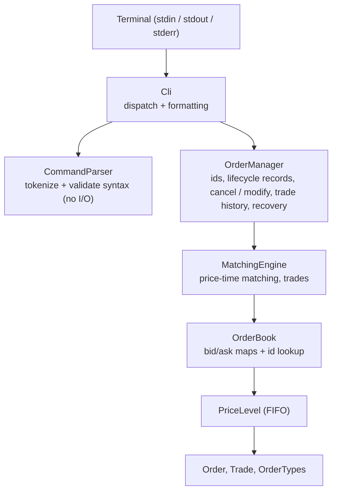

# Limit Order Book & Matching Engine (C++17)

An interactive limit order book with a **price-time-priority matching engine**, written in C++17 using only the
standard library. Orders arrive, trade against resting orders at the best price (oldest first), and whatever is
left rests in the book. Orders can be cancelled and modified, and every order keeps a complete lifecycle and trade
history. The project emphasizes correctness evidence (an independent reference model, system-level invariant
audits, deterministic fault injection) and honest measurement.

- **412 tests in 18 suites**, zero compiler warnings, no external dependencies.
- **Windows** with GCC/MinGW-w64, CMake and Ninja. **Windows 11 is verified; Windows 10 is not verified.** No
  other operating system or compiler has been tried.
- Released under the [MIT License](LICENSE).

## Features

- Limit orders on both sides with strict **price-time priority**; trades execute at the **resting order's price**.
- Partial and complete fills; one trade record per execution (buyer, seller, maker, taker, price, quantity).
- **Cancel** (including partially filled orders) and **modify** (price and/or remaining quantity) with
  exchange-style priority rules.
- Lifetime-unique order ids (generated or client-supplied; never reused, even after fills or cancels).
- Full lifecycle history per order and per-order trade history, kept for the whole session.
- Market data: best bid/ask, spread, exact mid-price, per-level aggregate quantity and order count, depth.
- Integer arithmetic only: prices are whole ticks, quantities whole units, and overflow is rejected, not wrapped.
- Invariant checking of the book and a consistency audit of the lifecycle records.
- Out-of-memory resilience: every allocation of each operation is failed in turn by the tests, and a `recover`
  command finishes bookkeeping left pending by a failure.
- An interactive command line with strict, safe input validation.

## Architecture



The CLI holds no order state: every fact it prints comes from `OrderManager`, and every change goes through it.
The core library performs no terminal I/O, so it is testable without a terminal. Bids and asks are
`std::map`s of price levels; each level is a FIFO `std::list` of orders; an `unordered_map` of order id to
list iterator makes cancellation by id cheap. See [docs/ARCHITECTURE.md](docs/ARCHITECTURE.md) for the design,
the guarantees and the reasoning.

## Requirements (Windows)

| Tool | Version used | Notes |
|---|---|---|
| Windows 11 | build 26200 | **Verified.** Every build, test and benchmark result in this repository was produced here |
| Windows 10 | - | **Not verified.** Nothing was built or run on it; it is expected to work only because the toolchain below supports it, and that expectation is untested |
| GCC (MinGW-w64) | 16.2.0, UCRT runtime | must be a C++17 compiler on `PATH` |
| CMake | 4.4.4 | `CMakeLists.txt` declares a minimum of 3.14. The commands below were chosen to avoid features newer than that (see "Build and test"), but only CMake 4.4.x was tested |
| Ninja | 1.13.2 | |

All three tools came from one winget package, `BrechtSanders.WinLibs.POSIX.UCRT`, which bundles GCC, CMake and
Ninja:

```
winget install BrechtSanders.WinLibs.POSIX.UCRT
```

That is how the toolchain used for every result in this repository was installed (the package is present in
`winget list` on the development machine); the install command itself was not re-run when writing this README.
Open a **new** terminal afterwards and check that the right tools resolve:

```
g++ --version        # should report GCC 16.2.0 (MinGW-W64 ... Brecht Sanders)
cmake --version
ninja --version
```

**Check the `g++` line carefully: another GCC earlier on `PATH` wins.** On the development machine an old
MinGW.org installation (`C:\MinGW\bin`, GCC 6.3.0) is on `PATH` ahead of WinLibs, and with it the build below fails
at configure time. If `g++ --version` is not the version you installed, put the WinLibs `bin` directory first for
the current terminal session (the path below is where winget placed it here):

```
# PowerShell
$env:PATH = "$env:LOCALAPPDATA\Microsoft\WinGet\Packages\BrechtSanders.WinLibs.POSIX.UCRT_Microsoft.Winget.Source_8wekyb3d8bbwe\mingw64\bin;$env:PATH"

:: cmd.exe
set "PATH=%LOCALAPPDATA%\Microsoft\WinGet\Packages\BrechtSanders.WinLibs.POSIX.UCRT_Microsoft.Winget.Source_8wekyb3d8bbwe\mingw64\bin;%PATH%"
```

Then run the three version commands again. To make it permanent, move that directory above the other GCC in your
user `PATH` (Windows "Edit environment variables").

### Missing GCC runtime DLLs

`lob_cli.exe`, `lob_bench.exe` and 17 of the 18 test executables import `libstdc++-6.dll` and
`libgcc_s_seh-1.dll` (checked with `objdump -p`); `libstdc++-6.dll` and `libgcc_s_seh-1.dll` in turn import
`libwinpthread-1.dll`. Windows finds them through `PATH`. (`lob_alloc_profile.exe` and `SystemFaultTests.exe` are
linked statically and need none.) If WinLibs is not on `PATH`, the program does not start: run from PowerShell,
`lob_cli.exe --help` printed nothing and exited with code `-1073741515` (`0xC0000135`, "DLL not found"). A CTest
run with only two of the three DLLs copied next to the test executables was observed idle (a test process at about
0 CPU) until it was killed, so a stuck test run is a symptom of this problem too.

The three DLLs are in the `bin` directory of the WinLibs package. On the development machine that is
`%LOCALAPPDATA%\Microsoft\WinGet\Packages\BrechtSanders.WinLibs.POSIX.UCRT_Microsoft.Winget.Source_8wekyb3d8bbwe\mingw64\bin`.
The commands below locate it instead of assuming the folder name; run them in PowerShell and check that the
last line prints `True` three times before continuing:

```powershell
$pkg = Get-ChildItem "$env:LOCALAPPDATA\Microsoft\WinGet\Packages" -Directory -Filter "BrechtSanders.WinLibs.POSIX.UCRT*" | Select-Object -First 1
$bin = Join-Path $pkg.FullName "mingw64\bin"
$bin
(Test-Path "$bin\libstdc++-6.dll"), (Test-Path "$bin\libgcc_s_seh-1.dll"), (Test-Path "$bin\libwinpthread-1.dll")
```

If `$pkg` is empty, WinLibs is not in the winget location (it was installed some other way); find the folder that
contains `g++.exe` (`where.exe g++`) and use that directory as `$bin`.

**Fix 1 (recommended): put that directory on `PATH` for the current terminal.**

```powershell
$env:PATH = "$bin;$env:PATH"
.\build\lob_cli.exe --help
```

**Fix 2: copy the three DLLs next to the executables.** This works without changing `PATH`, but only for the
directories you copy into, and the copies must be repeated after deleting `build\`:

```powershell
foreach ($d in "build", "build\tests", "build\benchmarks") {
    Copy-Item "$bin\libstdc++-6.dll", "$bin\libgcc_s_seh-1.dll", "$bin\libwinpthread-1.dll" $d
}
```

Copying only two of the three is not enough. Both fixes were tested from a PowerShell whose `PATH` contained no
MinGW or WinLibs directory: with Fix 1 or Fix 2 `lob_cli.exe` ran and CTest passed 18 of 18. Do not copy DLLs from
the old `C:\MinGW\bin` installation; they belong to GCC 6.3.0, not to the compiler that built the executables.

## Build and test

From the repository root, in PowerShell or `cmd.exe`:

```
cmake -S . -B build -G Ninja
cmake --build build
cd build
ctest --output-on-failure
cd ..
```

`ctest` is run from inside `build` rather than with `ctest --test-dir build`, because `--test-dir` needs CMake 3.20
while the project declares 3.14. The other flags used (`-S`, `-B`, `--build`, `--output-on-failure`) are documented
as available before 3.14; that is from the CMake documentation, not tested here (only CMake 4.4.x was run).

Release is the default build type. To build with warnings as errors, as the project is developed:

```
cmake -S . -B build -G Ninja -DLOB_WARNINGS_AS_ERRORS=ON
```

Other options: `-DLOB_BUILD_TESTS=OFF` and `-DLOB_BUILD_BENCHMARKS=OFF` (both on by default). On the development
machine a clean build took between about 16 and 52 seconds (it varies with the machine state described under
Benchmarks) and the Release test run about 18 seconds.

## Run

```
.\build\lob_cli.exe            # interactive, with a banner and a "lob> " prompt
.\build\lob_cli.exe --quiet    # no banner or prompt (for scripted input)
.\build\lob_cli.exe --help
```

Type `exit` or `quit` to leave. Closing standard input also exits cleanly.

**Scripted use** (a verified `cmd.exe` example; create a command file, then redirect it):

```
(echo submit BUY 100 50& echo submit SELL 99 30& echo book& echo exit)> commands.txt
build\lob_cli.exe --quiet < commands.txt
```

> **Windows encoding caveat.** The CLI does not strip a UTF-8 byte-order mark, so a BOM at the very start of
> standard input makes the first command fail ("unknown command"). Windows PowerShell 5.1 pipelines to native
> programs produced such a BOM when tested, and some editors save files with one. Use a plain-ASCII command file
> with `cmd.exe` redirection as above, or type commands interactively.

## Commands

| Command | What it does |
|---|---|
| `submit <BUY\|SELL> <PRICE> <QUANTITY> [ID]` | Enter a limit order. Without `ID` one is generated by the order manager and shown. Prints acceptance or rejection, executed and remaining quantity, final state and any trades. |
| `cancel <ORDER_ID>` | Cancel the remaining quantity of an active order. Shows the executed quantity (kept) and the cancelled quantity. |
| `modify <ORDER_ID> <NEW_PRICE> <NEW_REMAINING_QUANTITY>` | Change price and remaining quantity. A price change or a quantity increase loses time priority; a quantity decrease keeps it; no change is rejected; quantity 0 is refused (use `cancel`). Shows before/requested values, the result and whether priority was preserved or reset. |
| `book` | All price levels: asks lowest first, bids highest first, with aggregate quantity and order count, plus best bid/ask, spread and mid-price. |
| `depth <LEVELS>` | The top `LEVELS` (1 to 1000) levels on each side. |
| `best` | Best bid, best ask, spread and mid-price. |
| `order <ORDER_ID>` | The order's lifecycle record: side, status, prices, quantities (submitted, effective, executed, remaining, cancelled), sequence, and any reject or cancel reason. Works for filled, cancelled and rejected orders. |
| `trades <ORDER_ID>` | The trades the order took part in, in execution order. |
| `recover` | Finish bookkeeping left pending by an out-of-memory failure. Safe to repeat. |
| `help` | The command list with examples. |
| `exit`, `quit` | Leave. |

Syntax errors go to standard error and never end the session. Business rejections (a duplicate id, a cancel of a
filled order, ...) are normal results on standard output. Input that can never be valid (a zero or negative price
or quantity, id 0) is refused by the parser and never reaches the order manager, so it does not consume an order
id.

### Price and quantity conventions

- **Prices are integer ticks.** One tick is the smallest price step; the program attaches **no currency value** to
  it. Output is labelled "ticks". **Quantities are integer units**, labelled "units".
- Prices and quantities are whole, positive, plain-decimal numbers. Decimals (`10.5`), exponents (`1e3`), a leading
  `+`, hexadecimal and anything that does not fit a 64-bit integer are **rejected with an error, never rounded or
  truncated**.
- Internally everything is integer arithmetic; there is no floating point anywhere in the engine. A mid-price that
  falls between ticks is shown exactly (for example `102.5`).
- Commands and `BUY`/`SELL` are case-insensitive. Extra spaces and tabs are ignored.

## Example session

Order 1 rests as a buy; a sell at a *lower* price then crosses it. The trade executes at the resting price (100),
not the sell's limit (99). (This transcript was checked against the real executable: the same commands produce
exactly this output.)

```
lob> submit BUY 100 50
Order 1: ACCEPTED  BUY 50 units @ 100 ticks  (generated id)
  status:    NEW
  executed:  0 units
  remaining: 50 units (resting in the book)
  trades:    none
lob> submit SELL 99 30
Order 2: ACCEPTED  SELL 30 units @ 99 ticks  (generated id)
  status:    FILLED
  executed:  30 units
  remaining: 0 units
  trades:    1
   TRADE ID  PRICE (ticks)  QTY (units)     BUYER    SELLER   TAKER       SEQ
          1            100           30         1         2    SELL         2
lob> book
ASKS (lowest price first)
  (none)
BIDS (highest price first)
   PRICE (ticks)  QUANTITY (units)   ORDERS
             100                20        1
MARKET
  Best bid:  100 ticks (20 units in 1 order)
  Best ask:  -
  Spread:    -
  Mid-price: -
lob> order 1
Order 1
  side:              BUY
  status:            PARTIALLY_FILLED
  price:             100 ticks (original 100)
  quantity (units):  submitted 50, effective 50
  executed:          30
  remaining:         20
  cancelled:         0
  sequence:          1 (submitted at 1)
  trades:            1
lob> trades 1
Trades for order 1 (execution order)
   TRADE ID  PRICE (ticks)  QTY (units)     BUYER    SELLER   TAKER       SEQ
          1            100           30         1         2    SELL         2
lob> cancel 1
Order 1: CANCELLED
  executed (kept): 30 units
  cancelled:       20 units
  state:           CANCELLED
  reason:          cancelled by request
lob> book
ASKS (lowest price first)
  (none)
BIDS (highest price first)
  (none)
MARKET
  Best bid:  -
  Best ask:  -
  Spread:    -
  Mid-price: -
lob> modify 1 100 5
Order 1: modify REJECTED (order is not active)
  current state: CANCELLED, remaining 0 units; the order is unchanged
lob> submit SELL 105 x
error: QUANTITY 'x' is not a valid whole number of units
```

`SEQ` in a trade is the arrival sequence of the incoming (taker) order that caused it.

## Recovery after an out-of-memory failure

The order manager can finish a trade but fail to allocate while updating its history. When that happens the book
is always correct, and the CLI is honest about the history:

- `order` and `trades` print a `WARNING` and label their output "possibly out of date" while bookkeeping is
  pending.
- Run **`recover`**. It asks the order manager to finish the pending work and reports either "Recovery complete"
  or "Recovery incomplete ... run 'recover' again". It never resubmits or re-executes anything, creates no
  duplicate trade associations, and can be repeated.
- If a `submit`, `cancel` or `modify` fails with an exception, the CLI says it **may already have executed and
  must not be resubmitted**; check `book` and `order <ID>` after `recover`. A generated id is not shown in that
  case; use `book` to see what is resting.

The guarantee for each operation (strong or basic) is tabulated in
[docs/ARCHITECTURE.md](docs/ARCHITECTURE.md#exception-safety-and-recovery).

## Testing and verification

```
cd build
ctest --output-on-failure
cd ..
```

Each suite is a separate executable in `build\tests\` and can be run directly (`CliEndToEndTests` takes the path
of `lob_cli.exe` as its first argument; CTest supplies it).

| Check | Result |
|---|---|
| Tests | **412 tests in 18 suites**, all passing |
| Release and Debug builds with `-Werror` | 0 warnings; 18/18 suites |
| UBSan (trap-on-error) and `_GLIBCXX_DEBUG` builds | 18/18 suites, no trap, no abort |
| Line coverage (gcov, all suites) | 88.35% (`OrderBook.cpp`) to 100% (`Order.cpp`, `Trade.cpp`) across the eight source files |
| Validation | independent reference model, system-level invariant auditor, seeded randomized workloads (35,160 steps compared with the model), boundary and adversarial sequences, deterministic allocation-failure injection, the real `lob_cli.exe` as a subprocess |
| Defects found by this work | four, all fixed (including a level-quantity overflow near `INT64_MAX`) |

These results show the code behaves correctly on everything exercised; they are not a proof of correctness.
AddressSanitizer, Clang, MSVC, Windows 10 and other operating systems were **not** available or not tried. The
full suite table, coverage per file, the fault-injection statistics and every known limitation are in
[docs/VERIFICATION.md](docs/VERIFICATION.md).

## Benchmarks

A reproducible benchmark suite (158 scenarios at the order-book, matching-engine and order-manager layers) lives
in `benchmarks/`. **Measured on one Windows 11 laptop (i7-13620H, GCC 16.2.0 `-O3`), pinned to one core, 21
repetitions after 2 warm-ups, medians shown.**

> **Machine-state caveat.** The same unmodified binary with the same command line ran about **2.2x slower** in
> two full runs than in a third (median ratio **2.26** across the 158 scenarios, 10th-90th percentile
> **1.89-2.49**), and the speed changed *inside* one run. The cause is not determined (no frequency or
> performance counters were recorded). Absolute numbers are therefore state-dependent, so both states are shown.
> Shapes held in both states; ratios moved by up to about 25%.

| Manager layer, 100k resting orders over 1000 levels (ns per operation, median) | Slower state | Faster state |
|---|---:|---:|
| resting submit | 843 | 391 |
| cancel in queue order (50k orders at one level) | 112 | 51 |
| cancel, random order | 747 | 411 |
| modify, price change (cancel/replace) | 1190 | 647 |
| mixed workload stream (narrow profile) | 676 | 289 |
| `bestBid` query | 2.75 | 1.20 |

Measured observations: cancelling costs about the same at any queue length (100 to 50,000; it varied by about
13%); random-order cancel is much slower than in-order cancel; cost grows with the number of active orders and price levels; cancels and lookups
allocate nothing. *Inferred, not measured:* the explanations (cache misses, which data structure dominates) - no
profiler or hardware counter was used. One optimization was tried and rejected. Details, latency percentiles,
the noisy scenarios and the raw data are in [docs/BENCHMARKS.md](docs/BENCHMARKS.md).

To run the benchmarks (Windows; `--pin` and the RAM report are Windows-specific options):

```
.\build\benchmarks\lob_bench.exe --quick                       # smoke test, a few seconds
.\build\benchmarks\lob_bench.exe --pin 2 --csv results.csv     # full run, about 7 minutes
.\build\benchmarks\lob_alloc_profile.exe                       # allocation counts
```

`lob_bench` refuses to run in a Debug build. Benchmarks are not part of `ctest`.

## Repository layout

```
include/      OrderTypes.h Order.h Trade.h PriceLevel.h OrderBook.h MatchingEngine.h ExecutionReport.h
              OrderManager.h CommandParser.h Cli.h
src/          the matching .cpp files and main.cpp
tests/        18 suites (*Tests.cpp); TestFramework.h (in-repo harness), FaultInjection.h, ReferenceExchange.h,
              SystemAuditor.h, Duel.h, WorkloadGenerator.h, TestRng.h
benchmarks/   Benchmark.cpp (lob_bench), AllocProfile.cpp (lob_alloc_profile), BenchHarness.h, Scenarios.h
docs/         ARCHITECTURE.md  VERIFICATION.md  BENCHMARKS.md
docs/benchmarks/   committed benchmark evidence: baseline CSVs, raw A/B and run-mode data, comparison scripts
CMakeLists.txt  LICENSE  .gitignore  .gitattributes
```

## Current limitations

- **Limit orders only** (no market, IOC or FOK orders); single-threaded; in-memory only (history is lost on exit).
- History is kept for the whole session and never pruned, so memory grows with the number of orders and trades.
- No tick size or currency is configured, so prices are raw ticks.
- A cancel/replace that runs out of memory part-way can lose the order being modified (it is reported as
  cancelled with reason "internal failure"); see the architecture document for the exact guarantees.
- A very long input line is rejected, but it is still read into memory first.
- A UTF-8 byte-order mark at the start of input is not stripped (see the encoding caveat above).
- With prices and quantities near `INT64_MAX`, adjacent numbers in the `book` table run together (cosmetic).
- Built and tested with GCC/MinGW-w64 on Windows 11 only; other compilers and operating systems are untested.
- Performance figures are measurements from one machine whose speed varied by about 2.2x between runs; they are
  not guarantees.

## Documentation

| Document | Contents |
|---|---|
| [docs/ARCHITECTURE.md](docs/ARCHITECTURE.md) | design, data structures, matching and lifecycle rules, exception safety and recovery, testing and benchmark architecture |
| [docs/VERIFICATION.md](docs/VERIFICATION.md) | test suites and counts, results per build configuration, coverage, defects found, limitations |
| [docs/BENCHMARKS.md](docs/BENCHMARKS.md) | methodology, results, scaling, bottleneck analysis (measured versus inferred), the machine-state discrepancy |
| [docs/benchmarks/ab/README.md](docs/benchmarks/ab/README.md), [docs/benchmarks/runmode/README.md](docs/benchmarks/runmode/README.md) | what the committed raw benchmark data contains |

## License

Released under the [MIT License](LICENSE). Copyright (c) 2026 Manthan Gala.
