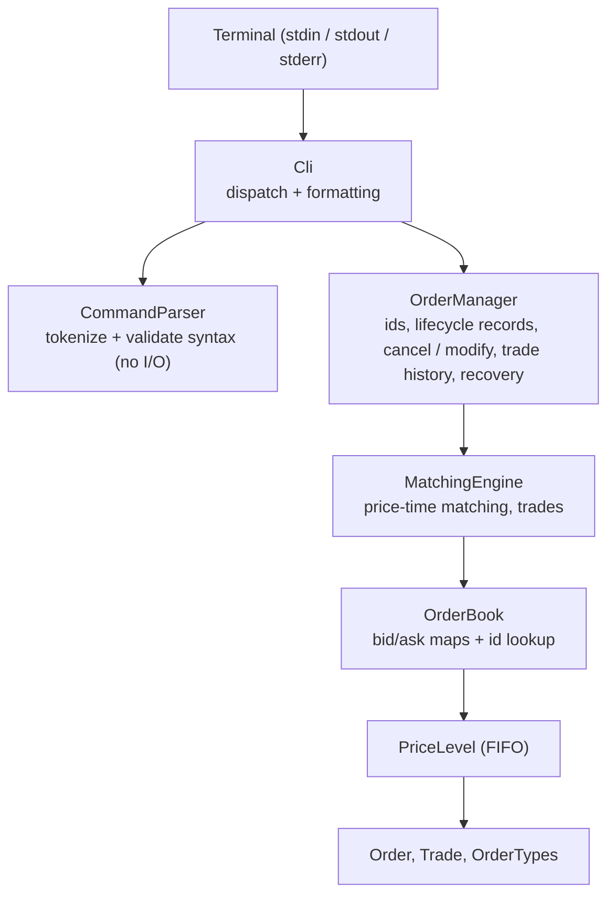

# Limit Order Book & Matching Engine (C++17)

An interactive limit order book with a price-time-priority matching engine, written in C++17 with only the standard library. It simulates the core of an exchange matching engine: orders arrive, trade against resting orders at the best price (oldest first), and whatever is left rests in the book. Orders can be cancelled and modified, and every order keeps a complete lifecycle and trade history.

**Status: Phase 6 of 9.** The engine, lifecycle manager and interactive CLI are implemented and tested. Benchmarks (Phase 8) and the final documentation pass (Phase 9) are not done yet, and no performance figures are claimed. See [docs/PROGRESS.md](docs/PROGRESS.md) and [docs/ARCHITECTURE.md](docs/ARCHITECTURE.md).

## Architecture overview



The CLI holds no order state of its own. Every fact it prints comes from `OrderManager`, and every change goes through it. The business logic has no terminal I/O, so it is fully testable without a terminal. Details are in [docs/ARCHITECTURE.md](docs/ARCHITECTURE.md).

## Features

- Limit orders on both sides with strict **price-time priority**; trades execute at the **resting order's price**.
- Partial and complete fills; one trade record per execution (buyer, seller, maker, taker, price, quantity).
- **Cancel** (including partially filled orders) and **modify** (price and/or remaining quantity) with exchange-style priority rules.
- Lifetime-unique order ids (generated or client-supplied; never reused, even after fills or cancels).
- Full lifecycle history per order and per-order trade history, kept for the whole session.
- Market data: best bid/ask, spread, exact mid-price, per-level aggregate quantity and order count, depth.
- Invariant checking of the book and a consistency audit of the lifecycle records.
- Out-of-memory resilience: deterministic fault-injection tests, and a `recover` command (see below).
- An interactive command line with strict, safe input validation.

## Prerequisites

- A C++17 compiler (developed and tested with GCC 16.2; see Limitations for other compilers).
- CMake 3.14 or newer. Ninja is optional.
- No external libraries.

## Build

```
cmake -S . -B build
cmake --build build
ctest --test-dir build --output-on-failure
```

To build with warnings as errors, as the project is developed:

```
cmake -S . -B build -DLOB_WARNINGS_AS_ERRORS=ON
```

## Run

```
./build/lob_cli            # interactive, with a banner and a "lob> " prompt
./build/lob_cli --quiet    # no banner or prompt (for piped or scripted input)
./build/lob_cli --help
```

On Windows the executable is `build\lob_cli.exe`. Scripted use:

```
printf 'submit BUY 100 50\nsubmit SELL 99 30\nbook\nexit\n' | ./build/lob_cli --quiet
```

End of input (Ctrl-D on Unix, Ctrl-Z then Enter on Windows) exits cleanly, the same as `exit`.

## Price and quantity conventions

- **Prices are integer ticks.** One tick is the smallest price step; the program attaches **no currency value** to it. Output is labelled "ticks".
- **Quantities are integer units**, labelled "units".
- Prices and quantities are whole, positive, plain-decimal numbers. Decimals (`10.5`), exponents (`1e3`), a leading `+`, and anything that does not fit a 64-bit integer are **rejected with an error, never rounded or truncated**.
- Internally everything is integer arithmetic; there is no floating point anywhere in the engine. A mid-price that falls between ticks is shown exactly (for example `102.5`).
- Commands and `BUY`/`SELL` are case-insensitive. Extra spaces and tabs are ignored.

## Commands

| Command | What it does |
|---|---|
| `submit <BUY\|SELL> <PRICE> <QUANTITY> [ID]` | Enter a limit order. Without `ID` one is generated by the order manager and shown. Prints acceptance or rejection, executed and remaining quantity, final state and any trades. |
| `cancel <ORDER_ID>` | Cancel the remaining quantity of an active order. Shows the executed quantity (kept) and the cancelled quantity. |
| `modify <ORDER_ID> <NEW_PRICE> <NEW_REMAINING_QUANTITY>` | Change price and remaining quantity. A price change or a quantity increase loses time priority; a quantity decrease keeps it; no change is rejected; quantity 0 is refused (use `cancel`). Shows before/requested values, the result and whether priority was preserved or reset. |
| `book` | All price levels: asks lowest first, bids highest first, with aggregate quantity and order count, plus best bid/ask, spread and mid-price. |
| `depth <LEVELS>` | The top `LEVELS` (1 to 1000) levels on each side. |
| `best` | Best bid, best ask, spread and mid-price. |
| `order <ORDER_ID>` | The order's lifecycle record: side, status, prices, quantities (submitted, effective, executed, remaining, cancelled), sequence, and any reject or cancel reason. Works for filled, cancelled and rejected orders. |
| `trades <ORDER_ID>` | The trades the order took part in, in execution order. |
| `recover` | Finish bookkeeping left pending by an out-of-memory failure. Safe to repeat. |
| `help` | The command list with examples. |
| `exit`, `quit` | Leave. |

Syntax errors go to standard error and never end the session. Business rejections (a duplicate id, a cancel of a filled order, ...) are normal results on standard output. Input that can never be valid (a zero or negative price or quantity, id 0) is refused by the parser and never reaches the order manager, so it does not consume an order id.

## Example session

Order 1 rests as a buy; a sell at a *lower* price then crosses it. The trade executes at the resting price (100), not the sell's limit (99).

```
lob> submit BUY 100 50
Order 1: ACCEPTED  BUY 50 units @ 100 ticks  (generated id)
  status:    NEW
  executed:  0 units
  remaining: 50 units (resting in the book)
  trades:    none
lob> submit SELL 99 30
Order 2: ACCEPTED  SELL 30 units @ 99 ticks  (generated id)
  status:    FILLED
  executed:  30 units
  remaining: 0 units
  trades:    1
   TRADE ID  PRICE (ticks)  QTY (units)     BUYER    SELLER   TAKER       SEQ
          1            100           30         1         2    SELL         2
lob> book
ASKS (lowest price first)
  (none)
BIDS (highest price first)
   PRICE (ticks)  QUANTITY (units)   ORDERS
             100                20        1
MARKET
  Best bid:  100 ticks (20 units in 1 order)
  Best ask:  -
  Spread:    -
  Mid-price: -
lob> order 1
Order 1
  side:              BUY
  status:            PARTIALLY_FILLED
  price:             100 ticks (original 100)
  quantity (units):  submitted 50, effective 50
  executed:          30
  remaining:         20
  cancelled:         0
  sequence:          1 (submitted at 1)
  trades:            1
lob> trades 1
Trades for order 1 (execution order)
   TRADE ID  PRICE (ticks)  QTY (units)     BUYER    SELLER   TAKER       SEQ
          1            100           30         1         2    SELL         2
lob> cancel 1
Order 1: CANCELLED
  executed (kept): 30 units
  cancelled:       20 units
  state:           CANCELLED
  reason:          cancelled by request
lob> book
ASKS (lowest price first)
  (none)
BIDS (highest price first)
  (none)
MARKET
  Best bid:  -
  Best ask:  -
  Spread:    -
  Mid-price: -
lob> modify 1 100 5
Order 1: modify REJECTED (order is not active)
  current state: CANCELLED, remaining 0 units; the order is unchanged
lob> submit SELL 105 x
error: QUANTITY 'x' is not a valid whole number of units
```

`SEQ` in a trade is the arrival sequence of the incoming (taker) order that caused it.

## Recovery after an out-of-memory failure

The order manager can finish a trade but fail to allocate while updating its history. When that happens the book is always correct, and the CLI is honest about the history:

- `order` and `trades` print a `WARNING` and label their output "possibly out of date" while bookkeeping is pending.
- Run **`recover`**. It asks the order manager to finish the pending work and reports either "Recovery complete" or "Recovery incomplete ... run 'recover' again". It never resubmits or re-executes anything, creates no duplicate trade associations, and can be repeated.
- If a `submit`, `cancel` or `modify` fails with an exception, the CLI says it **may already have executed and must not be resubmitted**; check `book` and `order <ID>` after `recover`. A generated id is not shown in that case; use `book` to see what is resting.

## Testing

```
ctest --test-dir build --output-on-failure
```

Each suite is a separate executable in `build/tests/` and can be run directly. The suites cover the domain types, price levels, the order book (with invariant checks), the matching engine, the order manager, deterministic allocation-failure injection, the command parser, the CLI end to end, and CLI recovery. The stress tests compare the engine against independent naive reference models. Test counts per suite are in [docs/PROGRESS.md](docs/PROGRESS.md).

## Project layout

```
include/   OrderTypes.h Order.h Trade.h PriceLevel.h OrderBook.h MatchingEngine.h
           ExecutionReport.h OrderManager.h CommandParser.h Cli.h
src/       the matching .cpp files, and main.cpp
tests/     one *Tests.cpp per suite, TestFramework.h (small in-repo harness), FaultInjection.h
docs/      ARCHITECTURE.md  PROGRESS.md
```

## Current limitations

- **Limit orders only** (no market, IOC or FOK orders); single-threaded; in-memory only (history is lost on exit).
- History is kept for the whole session and never pruned, so memory grows with the number of orders and trades.
- No tick size or currency is configured, so prices are raw ticks.
- A cancel/replace that runs out of memory part-way can lose the order being modified (it is reported as cancelled with reason "internal failure"); see the architecture document for the exact guarantees.
- A very long input line is rejected, but it is still read into memory first.
- Tested with GCC 16.2 only; Clang and MSVC have not been tried.
- No benchmarks or performance claims yet (Phase 8).
