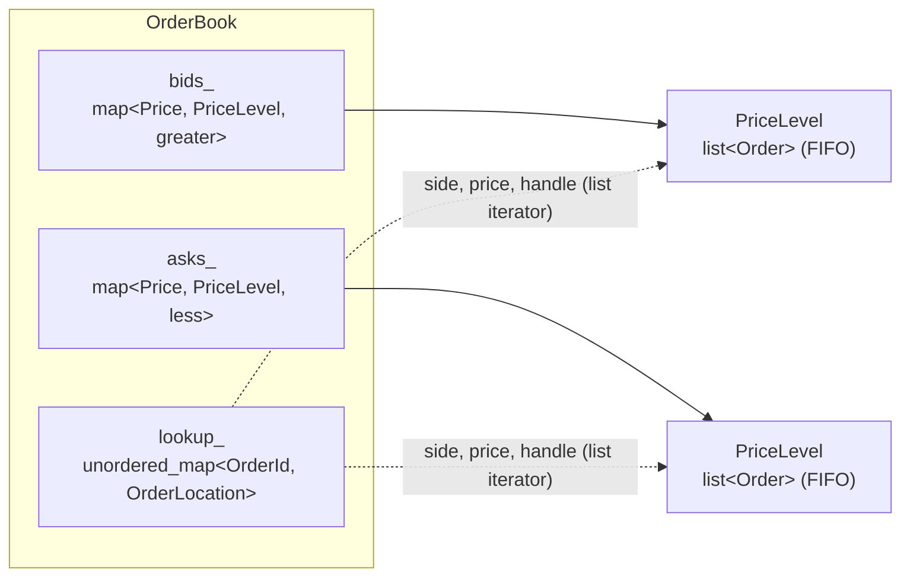
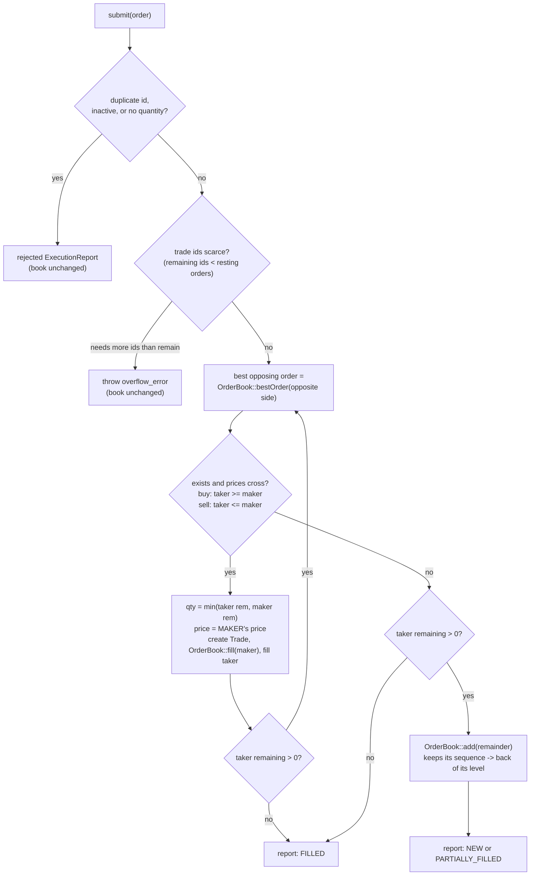
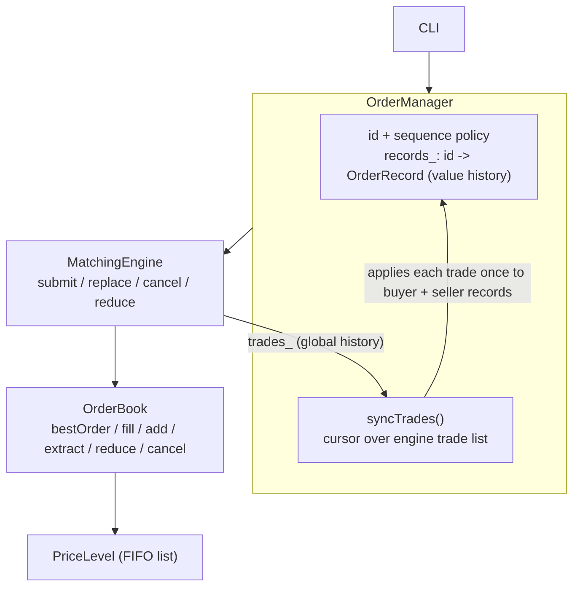
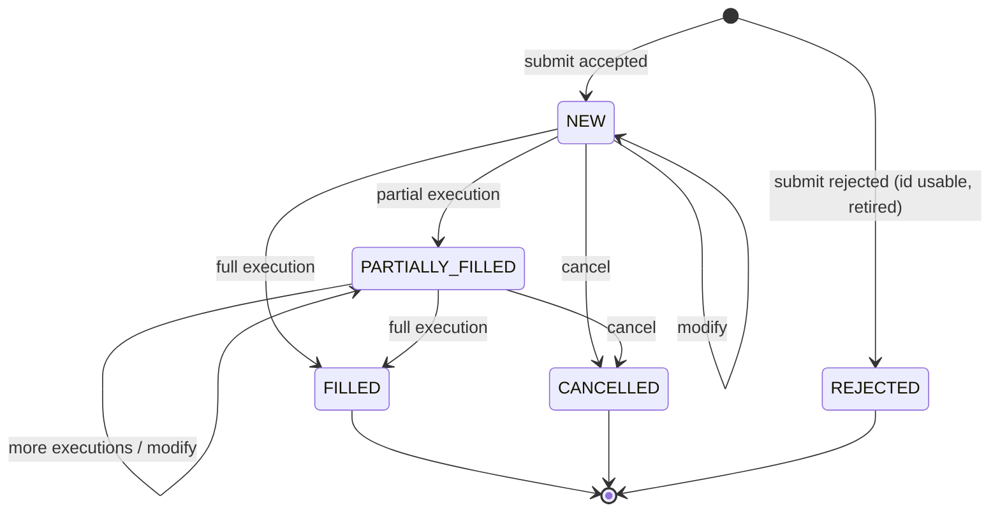
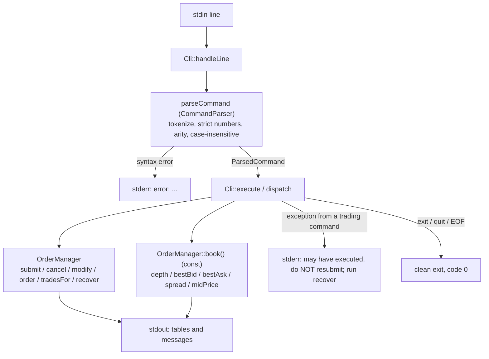
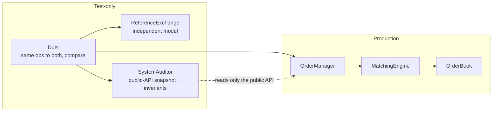

# Architecture

How the matching engine is built, why, and how each design claim is checked. Companion documents:
[VERIFICATION.md](VERIFICATION.md) (test results, coverage, limitations) and
[BENCHMARKS.md](BENCHMARKS.md) (performance measurements and their caveats).

Statements about asymptotic complexity in this document are **analytical**. Statements about measured
performance are labelled and point to BENCHMARKS.md; explanations of *why* a measurement came out as it did are
labelled *inferred* wherever no experiment tests them.

## Contents

1. [Layering and build structure](#layering-and-build-structure)
2. [Core types](#core-types)
3. [Domain models](#domain-models)
4. [OrderBook](#orderbook)
5. [Matching engine](#matching-engine)
6. [Order lifecycle manager](#order-lifecycle-manager)
7. [Exception safety and recovery](#exception-safety-and-recovery)
8. [Command line interface](#command-line-interface)
9. [Testing and validation architecture](#testing-and-validation-architecture)
10. [Benchmark design](#benchmark-design)
11. [Performance characteristics: measured and inferred](#performance-characteristics-measured-and-inferred)
12. [Data structure summary and decisions](#data-structure-summary-and-decisions)

## Layering and build structure

```
CLI (Cli) + CommandParser      parsing + printing only, no business logic
        |
OrderManager                   id policy, lifecycle history, cancel / modify, recovery
        |
MatchingEngine                 price-time matching, trade generation
        |
OrderBook -> PriceLevel        storage, ordering, lookup, invariants
        |
OrderTypes / Order / Trade / ExecutionReport   plain domain types
```

Dependencies only point downward. The core library performs no I/O (confirmed: no `<iostream>`, `<fstream>`,
`<cstdio>` or `printf` in any core source or header), so the CLI could be replaced by an API or a replay tool.
`ExecutionReport` and `OrderRecord` are plain value types.

| CMake target | Kind | Contents |
|---|---|---|
| `lob_core` | static library | `Order`, `Trade`, `PriceLevel`, `OrderBook`, `MatchingEngine`, `OrderManager` |
| `lob_ui` | static library | `CommandParser`, `Cli`; links `lob_core`, and the core never depends on it |
| `lob_cli` | executable | `src/main.cpp`: wires `std::cin` / `std::cout` / `std::cerr` and `--quiet` / `--help` to a `Cli` |
| 18 test executables | one per suite, each a CTest entry | link `lob_ui` and `lob_core` (sources are compiled once) |
| `lob_bench`, `lob_alloc_profile` | executables, **not** CTest entries | see [Benchmark design](#benchmark-design) |
| `lob_warnings` | interface target | the shared warning flags |

CMake options: `LOB_BUILD_TESTS` (ON), `LOB_BUILD_BENCHMARKS` (ON), `LOB_WARNINGS_AS_ERRORS` (OFF). The default
build type is Release when none is given. The warning flags are `-Wall -Wextra -Wpedantic -Wshadow -Wconversion
-Wsign-conversion` (plus `-Werror` when requested); the project file also contains an MSVC branch, which has not
been exercised.

**Platform scope.** The project targets Windows with GCC/MinGW-w64, CMake and
Ninja. Windows 11 is verified; Windows 10 is not verified (nothing was run on it). Two CMake details are MinGW-specific: `SystemFaultTests` and
`lob_alloc_profile` are linked with `-static` so every allocation, including those inside the standard library,
goes through the replacement `operator new` (with the shared libstdc++ DLL, `std::string` allocates through the
DLL's own `operator new`). Some test and benchmark source files contain non-Windows branches (for example
`sys/wait.h` in `CliEndToEndTests.cpp`); they have never been compiled or run here and are not a support claim.

## Core types

`include/OrderTypes.h`.

- `Price` and `Quantity` are signed 64-bit integers. Price is in integer ticks, so there is no floating-point
  error. They are signed so that bad input such as `-5` can be represented and rejected explicitly instead of
  wrapping around. Ids and trade ids are unsigned 64-bit.
- Enums: `Side`, `OrderType` (limit only), `OrderStatus`, `Operation`, `RejectReason`, `CancelReason`.
- `canTransition` encodes the legal order lifecycle in a single place.

### Order lifecycle

```
NEW --(partial fill)--> PARTIALLY_FILLED --(partial fill)--> PARTIALLY_FILLED
 |                              |
 |--(full fill)--> FILLED <-----|
 |--(cancel)-----> CANCELLED <--|
 '--(validation fails)--> REJECTED
```

FILLED, CANCELLED and REJECTED are terminal. A terminal order is never in the book or in the lookup map.

## Domain models

### Order (`include/Order.h`, `src/Order.cpp`)
- The constructor is private. `Order::create(...)` returns `std::optional<Order>`, so an `Order` that exists is
  always valid: id > 0, price > 0, quantity > 0, `0 <= remaining <= original`, and
  `executed == original - remaining`. `Order::validate` reports the first failing check as a `RejectReason`, in
  the order id, price, quantity.
- Fields: id, side, type, price (ticks), original/remaining quantity, `sequence` (the time-priority counter) and
  status. The model never reads a clock, so tests and replays are deterministic.
- Mutators are `fill(qty)`, `cancel()`, `reject()`, `reduceTo(qty)` and `replaced(price, qty, sequence)`. Each
  validates the transition before changing anything, so a failed call leaves the order untouched.
- Misuse (a bad fill quantity, or acting on a terminal order) throws `std::invalid_argument` /
  `std::logic_error`. External input is checked up front and reported through `create` / `validate`, so these
  exceptions mean a caller bug, not bad user data.

### Trade (`include/Trade.h`, `src/Trade.cpp`)
- Immutable: only getters, and construction goes through `Trade::create`, which returns `std::nullopt` unless the
  trade id, maker id and taker id are > 0, maker != taker, and price and quantity are > 0.
- It stores maker (resting), taker (incoming) and the **taker side**. `buyOrderId()` and `sellOrderId()` are
  derived from that, so every trade traces back to its buyer and seller.
- The resting-price execution rule belongs to the matching engine; `Trade` only guarantees the price is valid.

### PriceLevel (`include/PriceLevel.h`, `src/PriceLevel.cpp`)
**Ownership.** The level owns its orders by value in a `std::list<Order>`. There are no raw pointers and no
shared ownership.

**Iterator strategy.** `std::list` keeps iterators and references to other elements valid when one element is
erased or others are appended. `add()` returns an `OrderHandle` (a `list::const_iterator`) that the `OrderBook`
stores in its id -> location map. `remove(handle)` can then erase from the middle of the queue in O(1). A handle
stays valid until the order it refers to is removed (by `remove`, `popFront`, or a `fill` that completes the
order). Using a handle after that, or on a different level, is a
precondition violation that is not detected, because a membership check would cost O(n). The `OrderBook` owns
that guarantee.

**Aggregate integrity.** Orders are exposed read-only (`front()`, `begin()`/`end()`). The only ways to change a
resting order's quantity are `PriceLevel::fill` and `PriceLevel::reduce`, which update the cached
`totalQuantity` in the same call. A fill that completes an order also removes it, so a filled order can never
keep resting. `checkInvariants()` recomputes the sum and verifies every order is active, positive and at the
level's price.

**Failure behaviour.** Preconditions throw and leave the level unchanged: `add` with a wrong price or an inactive
order, `front`/`popFront` on an empty level, `remove`/`fill` with `end()`, a bad fill quantity, and an `add` that
would overflow the level's total quantity.

| Operation | Time (analytical) | Notes |
|---|---|---|
| `add` | O(1) | `push_back`, one node allocation |
| `front`, `empty`, `orderCount`, `totalQuantity`, `price` | O(1) | `std::list::size()` is O(1) since C++11 |
| `popFront`, `remove(handle)`, `fill(handle, qty)`, `reduce(handle, qty)` | O(1) | `fill` erases the node only if the order completes |
| iteration | O(n) | n = orders at this level |
| `checkInvariants` | O(n) | test and debug use only |

Space is O(n) for n resting orders: one list node per order (the `Order` plus two links and allocator overhead),
plus O(1) for the level itself. `std::list` has worse cache locality than a contiguous container; that is the
accepted trade-off for O(1) middle removal and stable handles (see [the decision below](#decision-stdlist-rather-than-stddeque-for-the-level-queue)).

## OrderBook

`include/OrderBook.h`, `src/OrderBook.cpp`. The book stores, indexes, cancels, fills and queries resting orders.
It does **not** decide what matches: that is the matching engine's job, which sits on top of it. The book itself
can still hold crossing orders if they are added directly.



### Representation
- **Bids:** `std::map<Price, PriceLevel, std::greater<Price>>`. **Asks:** `std::map<Price, PriceLevel,
  std::less<Price>>`. In both, `begin()` is the best price, so best bid and best ask are O(1).
- **Lookup:** `std::unordered_map<OrderId, OrderLocation>` with `OrderLocation { Side side; Price price;
  PriceLevel::OrderHandle handle; }`. It is the only id index, and it spans both sides, so id uniqueness is
  enforced globally.
- Each side is written once as a template over the map type (`addTo`, `removeFrom`, `checkSide`), so the buy and
  sell sides share one code path. All FIFO and aggregate logic stays in `PriceLevel`.
- The lookup stores the **price**, not a map iterator, and finds the level with an O(log P) `find`. This costs a
  log factor on cancel. In return one `OrderLocation` type serves both sides, and the entry cannot dangle when a
  level is erased.

### Iterator and ownership safety
- Levels own orders; the book owns levels; the lookup holds only non-owning handles.
- A handle is invalidated only when its order leaves its level. Every removal path erases the lookup entry in
  the same operation, and a level is erased only once it is empty, so no handle can point into it. `std::map`
  nodes never move, so adding or erasing other levels cannot disturb handles.
- `add` has the strong exception guarantee. The level is created first, and any later failure (the lookup
  insertion) removes the order again and erases a level that was left empty.
- `OrderBook` is **move-only**: moving a `std::list` or `std::map` keeps iterators valid, but a copy would leave
  the lookup pointing into the source book's lists, so copying is deleted. A test checks that handles still work
  after a move.
- `checkInvariants()` compares handles for equality and never dereferences one it has not validated.

### Policies
- **Id reuse:** ids are unique among *resting* orders. Once an order is cancelled its id can be added to the book
  again (a test covers this). The `OrderManager` remembers retired ids; the book does not.
- **Sequence:** callers submit non-decreasing `sequence` values in arrival order. FIFO position is insertion
  order, and the invariant checker verifies it agrees with `sequence`. The book does not itself reject
  out-of-order sequences.
- **Rejections from `add`:** `DuplicateOrderId`, `OrderNotActive`, `InvalidQuantity` (no remaining quantity),
  `QuantityOverflow` (resting it would overflow its level's total quantity). Price, id and quantity validity is
  already guaranteed by `Order::create`. A rejected add leaves the book unchanged.
- **`cancel(id)`:** returns the removed order marked CANCELLED, or `std::nullopt` for an unknown id (including a
  repeated cancel, because the entry is gone). `extract(id)` removes without changing state; `cancel` is
  `extract` plus marking CANCELLED. `reduce(id, qty)` lowers a resting order's remaining quantity in place.
- **Engine-facing operations:** `bestOrder(side)` (the highest-priority resting order, read-only) and
  `fill(id, qty)` (executes against a resting order by id; validates before mutating and throws without changing
  anything on an unknown id or a bad quantity; a completing fill removes the order, its lookup entry and an
  emptied level in the same call).

### Market data
- `bestBid()` / `bestAsk()` return a `LevelSummary {price, totalQuantity, orderCount}` or `nullopt`.
- `spread()` is `bestAsk - bestBid`. It is zero or negative only while the book is crossed, and it cannot
  overflow because both prices are positive.
- `midPrice()` returns `Midpoint {ticks, halfTick}`: `ticks` is floor((bid + ask) / 2) and `halfTick` says the
  exact value is `ticks + 0.5`. There is no floating point. It is computed as `bid/2 + ask/2 + (carry of the two
  odd bits)/2`, so it never forms `bid + ask`, which could overflow near the `Price` maximum (a test covers
  this).
- `depth(n)` returns the top `n` levels per side, best first, as plain value snapshots. `bids()` / `asks()` give
  const access to the maps for display; nothing mutable is exposed.
- `contains(id)`, `find(id)` (a non-owning `const Order*`, valid until that order leaves the book),
  `orderCount()`, `bidLevelCount()`, `askLevelCount()`, `empty()`.

### Invariants (`checkInvariants()` returns an `InvariantReport` listing each violation)
1. Every price level is non-empty.
2. Bid prices are strictly descending.
3. Ask prices are strictly ascending. (Each level's map key also equals its `price()`.)
4. Every order is on the side whose map contains it.
5. Every order's price equals its level's price.
6. Order ids are unique across both sides.
7. Every resting order has a lookup entry, and that entry has the same side, price and handle.
8. Every lookup entry refers to a resting order. This follows from 7, unique ids (6) and equal counts (11): N
   distinct orders each matched to a distinct entry, with N entries in total, leaves no extra entry.
9. Each level's aggregate equals the sum of its orders' remaining quantities (and the level's own checks pass:
   orders active, remaining > 0).
10. FIFO: within a level, sequences never decrease in queue order.
11. Total orders across all levels equals the lookup size.

The public API cannot produce a corrupt book, so the failure branches of this checker have **no committed
test**. During development the checker was confirmed to report a missing entry, an extra entry, a wrong-node
entry, drifted aggregates and an empty level, using a throwaway harness that deliberately corrupted a book and
was not committed; that confirmation is not reproducible from the repository.

### Complexity (analytical; P = price levels on the affected side, L = orders in the level, N = resting orders, D = levels requested)

| Operation | Time | Notes |
|---|---|---|
| `add` | O(log P) + average O(1) | map `find`/insert for the level, O(1) append, average O(1) hash insert. Hash insert is O(N) worst case on a degenerate hash. |
| `cancel` | O(log P) + average O(1) | hash lookup, O(1) removal by handle, then an O(log P) map `find` to reach the level, plus an O(log P) erase if the level empties. **Not O(1) overall.** |
| `contains`, `find` | average O(1) | O(N) worst case |
| `bestBid`, `bestAsk`, `spread`, `midPrice` | O(1) | `begin()` of an ordered map |
| `depth(D)` | O(D) | walks D levels; allocates O(D) |
| `orderCount`, level counts, `empty` | O(1) | |
| `checkInvariants` | O(N) average | one pass plus hash lookups, plus a second id-uniqueness pass |

Space is O(N) for the orders, O(P) for the map nodes, and O(N) for the lookup (one hash node per order). The
lookup is the extra cost of maintaining a second index: every add and cancel updates both structures, which is
what makes the consistency checks necessary.

## Matching engine

`include/MatchingEngine.h`, `src/MatchingEngine.cpp`, `include/ExecutionReport.h`.



### Responsibilities
- **MatchingEngine** decides *what* trades: it picks the maker, applies the price rule and quantity, creates
  `Trade`s, and rests the remainder. It owns the `OrderBook` and the trade history. It also offers `cancel(id)`,
  `reduce(id, qty)` and `replace(id, price, qty, sequence)` (cancel/replace as one atomic engine step).
- **OrderBook** owns *how* state changes. The engine never touches maps, lists or the lookup directly; it uses
  only `bestOrder(side)`, `fill(id, qty)`, `add`, `extract`, `reduce`, `contains`, `orderCount` and read-only
  views.

### Price-time priority
- **Price first:** the maps are ordered best-first, so `bestOrder` is always the best price. **Then time:**
  within a level, the front of the list is the oldest arrival. Matching never skips an older eligible order.
- A partially filled maker is not moved. Only its remaining quantity changes, so it keeps its place at the front.
- A rested remainder is added with the order's original `sequence`, so it queues behind everything already at
  that price. The engine adds no clock or sequence of its own.
- The incoming order trades against everything eligible, best price outward, before any remainder rests, so the
  book is never left crossed by a normal submission.

### Execution price
Every trade executes at the **maker's (resting) price**, so an aggressive order gets price improvement. A buy at
110 against a sell at 105 trades at 105, and a sell at 95 against a bid at 100 trades at 100. The remainder of an
incoming order rests at its own limit price, not at a trade price.

### Quantity overflow guard
A price level keeps its aggregate quantity in a signed 64-bit integer. Without a bound, two orders of `INT64_MAX`
at one price would wrap the level total negative (undefined behaviour). The rule is enforced in three layers:
- **`MatchingEngine::submit` / `replace`** check *before any mutation* whether the order, resting in the worst
  case (its whole quantity), would overflow its own side's level at its price. If so the order is rejected with
  `RejectReason::QuantityOverflow`: no trade has executed and the book is untouched. The check is deliberately
  conservative: an order that would in fact have matched completely is also refused if its own side's level at
  that price is within its quantity of `INT64_MAX`. For a replacement, the order's own old quantity is not
  counted when it stays in the same level.
- **`OrderBook::add`** independently returns `QuantityOverflow` (book unchanged).
- **`PriceLevel::add`** throws `std::invalid_argument` (level unchanged) as a precondition guard.

At the manager, a submission rejected this way is recorded as REJECTED (the id is retired, and a sequence number
is consumed); a modification rejected this way leaves the order untouched (and also consumes a sequence number,
since sequence allocation precedes the engine call). Orders whose combined quantity is exactly `INT64_MAX` are
accepted. This defect was found by the validation work described in [VERIFICATION.md](VERIFICATION.md).

### Fills and trades
`quantity = min(taker remaining, maker remaining)`. Each execution produces its own `Trade`, so one order
sweeping K resting orders yields K trades. A maker fully consumed is removed; a maker partially consumed stays
with the reduced quantity as PARTIALLY_FILLED.

- `Trade` fields: id, maker (resting) id, taker (incoming) id, taker side, price, quantity, sequence.
- **Timestamp:** `Trade::sequence` is the taker's `sequence`, the arrival event that caused the execution.
  Trades from one taker share it and are ordered by trade id. No clock is read, so runs are fully
  deterministic.
- **Trade ids:** a plain counter starting at `firstTradeId` (default 1), issued in execution order, with no
  randomness. Ids are never reused and never wrap. When `UINT64_MAX` is issued the engine is exhausted, and
  anything that would need another id throws `std::overflow_error`. This is checked **before any mutation**: if
  remaining ids are fewer than the resting orders (a cheap test), the engine dry-runs the match read-only,
  counts the executions needed, and refuses if they exceed what remains. An order that would not trade can
  still rest after exhaustion.
- The engine keeps the full history (`trades()`, a `std::vector<Trade>`), and each report carries the trades of
  that submission.

### ExecutionReport
A plain value type (no I/O) shared by the manager and the CLI:
`operation, orderId, accepted, rejectReason, cancelReason, status, originalQuantity, executedQuantity,
remainingQuantity, trades`.
- `accepted == false` means rejected (duplicate id, inactive order, no quantity, or invalid raw input). `status`
  is REJECTED and nothing changed.
- `accepted` with `status NEW` and no trades means it rested without trading, which is distinguishable from a
  rejection.
- `PARTIALLY_FILLED` means it traded and the remainder rests. `FILLED` means it fully executed and nothing rests.
- `remainingQuantity` is the quantity still working in the book. The final state lives only in `status`.
- `submit(id, side, price, qty, sequence)` validates raw input with `Order::validate` and turns invalid id, price
  or quantity into a rejected report. `submit(Order)` takes an already valid order.

### Complexity (analytical; P = price levels on the opposite side, K = executions, N = resting orders)

| Operation | Time | Notes |
|---|---|---|
| Best opposing price / oldest order (`bestOrder`) | O(1) | `begin()` of the ordered map and `front()` of the list |
| One execution | O(log P) + average O(1) | hash lookup of the maker, O(1) level update, a map `find` to reach its level and an O(log P) erase if the level empties |
| Matching against K resting orders | O(K log P) + average O(K) | the number of executions drives the cost, not the book size |
| Inserting an unfilled remainder | O(log P) + average O(1) | the same as `OrderBook::add` |
| Trade-id exhaustion dry run | O(K) | only when remaining ids are fewer than N |

An order that does not trade costs the O(1) best-price check plus `add`.

## Order lifecycle manager

`include/OrderManager.h`, `src/OrderManager.cpp`.





### Responsibilities
`OrderManager` owns id policy, one `OrderRecord` per order ever recorded, the trade-to-order associations, and the
operations `submit`, `cancel` and `modify`. It owns a `MatchingEngine` and never touches the book's containers: it
reads the book through `book()` and mutates it only through the engine's public operations. It has no I/O and no
parsing. `ExecutionReport` is the single result type for submit, cancel and modify (`operation` says which).

### Order id policy
- Ids are unique **for the life of the manager**. Every id ever recorded stays in `records_` whether the order was
  filled, cancelled or rejected. The book's resting-id set is deliberately not the source of truth.
- Ids are client-supplied (`submit(id, ...)`) or generated (`submit(...)`). The generator is a counter starting at
  `firstGeneratedId` (default 1) that skips ids clients have used and never wraps: after `UINT64_MAX` is issued,
  generated submissions are rejected with `IdSpaceExhausted`.
- **Rejected submissions.** A submission with a *usable* id (non-zero, unused) is recorded as REJECTED even if its
  price or quantity was invalid, and that id is retired: it cannot be resubmitted, cancelled or modified. This
  keeps an audit trail and means a rejected id can never later be confused with a live order. A submission with
  *no* usable id is rejected without a record: id 0 (`InvalidOrderId`), an id already used (`DuplicateOrderId`; the
  existing order is untouched), an invalid side (`InvalidSide`, checked first so no id is burned), or an exhausted
  generator.
- The manager also assigns the time-priority `sequence` from one increasing counter (one per accepted submission
  and per modification that loses priority). It likewise never wraps.

### Lifecycle records
An `OrderRecord` is a plain value (no pointer into the book), so it stays valid however the order leaves it. It
holds the side, original and current price, submission and current sequence, status, reject and cancel reasons,
and the quantities below. `order(id)` returns a copy.

| Quantity | Meaning |
|---|---|
| `submittedQuantity` | what the client asked for; never changes |
| `effectiveQuantity` | executed + still working (+ cancelled once cancelled); equals the submitted quantity until a modification |
| `executedQuantity` | cumulative; only grows; no modification touches it |
| `remainingQuantity` | still working in the book; 0 once filled, cancelled or rejected |
| `cancelledQuantity` | what was working when the order was cancelled |

Always `executed + remaining + cancelled == effective`. The in-book `Order::originalQuantity` is kept equal to
`effectiveQuantity`.

### Submission workflow
1. Check side, then id (client id: non-zero and unused; generated: allocate), then price/quantity via
   `Order::validate`, then allocate a sequence. A failure here is a rejection (recorded or not, per the policy
   above).
2. Insert the record **before** the order can reach the book, so a resting order never lacks a record.
3. `engine.submit`. If the engine reports that trade ids cannot cover the order (`std::overflow_error`, raised
   before anything changed), the record becomes REJECTED / `TradeIdsExhausted`.
4. `syncTrades()` applies the resulting trades to the buyer and seller records. The returned report is built from
   the record, plus the trades.

### Cancellation workflow
Only ACTIVE orders can be cancelled. Unknown id gives `OrderNotFound`. Filled, already-cancelled and rejected
orders give `OrderNotActive` (the report still shows the order's real status and quantities). Otherwise
`engine.cancel(id)` removes it from the book and the record becomes CANCELLED with `cancelledQuantity` = what was
left, `remainingQuantity` 0, and reason `UserRequested`. Executed quantity and trade history are untouched. The
record update is plain assignment after the engine call, so the operation is strong.

### Modification workflow and priority
`modify(id, newPrice?, newRemainingQuantity?)`: the quantity is the new *remaining* quantity, and the cumulative
executed quantity is never altered, so the effective total is executed + new remaining.

| Request | Behaviour |
|---|---|
| nothing, or values equal to the current ones | rejected `NoChange`; the order and its priority are untouched |
| price unchanged, remaining decreased | in place (`reduce`); **keeps time priority** |
| price unchanged, remaining increased | **loses priority**: cancel/replace, back of its queue |
| price changed (any quantity) | **loses priority**: cancel/replace, back of the queue at the new price |
| price <= 0, or remaining <= 0 | `InvalidPrice` / `InvalidQuantity` (use cancel to remove an order) |
| unknown / filled / cancelled / rejected order | `OrderNotFound` / `OrderNotActive` |

Worked example: BUY 100 @ 100 has executed 40, remaining 60. Modifying remaining to 30 gives executed 40,
remaining 30, effective 70, and it keeps its place. Modifying remaining to 80 gives executed 40, remaining 80,
effective 120, and it moves to the back of its price level.

**Cancel/replace** (`MatchingEngine::replace`): while the order still rests, everything that can fail logically
is checked (existence, values, quantity overflow, trade-id capacity). Then the order is extracted and its
replacement (same id and executed quantity, new price/quantity/sequence) goes through normal matching, so a new
price that crosses the book trades at resting prices before any remainder rests at the back of the new queue.
The order is outside the book only inside this call, so two orders with one id never coexist. After a successful
replace, the record's price, sequence, remaining and effective quantity are updated and the replacement's trades
are applied.

### Trade history
The engine owns the single global trade list (`trades()`). Each `OrderRecord` stores the **indices** of its
trades (buyer or seller), strictly increasing, which is execution order. `tradesFor(id)` returns copies of those
trades. The records are updated only by `syncTrades()`, which walks the engine's list from a persistent cursor and
applies each trade to its buyer's and seller's record exactly once (reserving capacity first, so a trade is
applied completely or not at all). That makes "each trade recorded exactly once" structural, and lets an
interrupted operation resume on the next call. Trades survive cancellation and full execution, since the history
is never erased.

### History retention
Every `OrderRecord` and every trade is kept for the lifetime of the `OrderManager`, and every recorded id stays
reserved for that lifetime. Memory therefore grows with the number of recorded orders and trades. There is
deliberately **no pruning API**. Any future retention or persistence policy must preserve id uniqueness (retired
ids must stay unavailable) and the semantics of `order()` and `tradesFor()` for old orders.

### API contracts
- `order()` returns a value copy; `tradesFor()` returns copies.
- `modify` with no change is rejected as `NoChange`. Remaining quantity 0 is rejected (cancel is the operation
  for that).
- A quantity decrease keeps FIFO priority. A price change or a quantity increase loses it.
- A recorded id (filled, cancelled or rejected) is never reused.
- After an exception from a mutating call, call `recover()` (or any mutating call) and check `isHistoryCurrent()`
  before trusting snapshots.
- Single-threaded.

### Verification aid
`checkConsistency()` (O(records + trades)) runs the book's invariants and checks every record against the book
(active records rest with identical side/price/quantities/sequence; terminal records are absent),
status/quantity coherence, that each record's trades involve it, are increasing and sum to its executed
quantity, and that every trade is recorded exactly once on its buyer and once on its seller. If recovery or trade
synchronization is pending, it reports the single `kHistoryNotCurrent` notice, audits each record against itself
and the trades already applied, and skips only the comparison with the book.

### Complexity (analytical; N = records, T = trades, P = price levels on the order's side, k = executions, t_o = trades of one order)

| Operation | Time | Notes |
|---|---|---|
| id validation / duplicate check | average O(1) | hash lookup in `records_` |
| generated id allocation | average O(1) amortized | skips client ids; bounded by the number of client ids used |
| `order(id)` | average O(1) + O(t_o) | O(t_o) only to copy the index vector |
| submit | O(log P) + average O(1) + k executions | the engine's cost (O(k log P)) plus O(k) to apply trades |
| cancel | O(log P) + average O(1) | hash lookups + queue removal by handle + level lookup/erase |
| modify, in place | O(log P) + average O(1) | `reduce` |
| modify, cancel/replace | O(log P) + average O(1) + k executions | extract + re-enter; plus an O(k) dry run only when trade ids are scarce |
| `tradesFor(id)` | O(t_o) | copies t_o trades by index |
| historical storage | O(N + T) space | no pruning, so memory grows without bound |
| `checkConsistency` | O(N + T) average | test/debug use |

Hash operations are *average* O(1) (O(N) worst case on a pathological hash). Ordered-map steps are O(log P).

## Exception safety and recovery

Every allocation an operation makes was failed, one at a time, by the fault-injection tests (design in
[Testing and validation architecture](#testing-and-validation-architecture)). "Strong" means an exception leaves
everything exactly as it was. "Basic" means the state is valid and consistent but the operation is only partly
done.

| Operation / failure point | Guarantee | Observed outcome |
|---|---|---|
| Business rejection (duplicate id, invalid price, no change, unknown order, ...) | n/a (a normal report, nothing thrown) | |
| `OrderBook::add` (level node, list node, lookup node, rehash) | **Strong** | book identical; swept for books of 0..30 orders, new and existing level |
| Rejected-submission record creation | **Strong** | no half-made record; id not burned |
| Submit that fails **before its first execution** (record creation, first trade, resting an untraded order) | **Strong** | the record is rolled back, so the id stays free and nothing is recorded |
| Submit that fails **after it has traded** (a later trade, or resting the remainder) | **Basic** | executions stand and are recorded exactly once; the order is CANCELLED with `SystemFailure` (`cancelledQuantity` = what was left), or FILLED if its executions completed it; the id stays retired; the exception is rethrown |
| Cancel/replace (price change or quantity increase) failing before the order leaves the book | **Strong** | order untouched, still in its queue position |
| Cancel/replace failing after the order left the book | **Basic** | the order is **not restored**: it is CANCELLED with `SystemFailure`, keeping its executed quantity; if it had already traded under the new terms, those trades are recorded against the new terms |
| `cancel`, in-place quantity reduction | **Strong, and allocation-free** | measured: 0 allocations, so they cannot throw `bad_alloc` at all |
| `OrderBook::extract` / `cancel` / `reduce` / `fill` | allocation-free | measured: 0 allocations |
| `order()`, `tradesFor()`, `depth()` | **Strong** (they only read) | state unchanged |
| Applying a trade to its two records | **Strong per trade** | capacity for both records is reserved before either is changed, so a trade is applied completely or not at all |

**Bookkeeping after a successful engine operation.** Applying the engine's trades to the lifecycle records can
itself fail to allocate. That does not turn a completed operation into an exception: `submit` / `modify` return
the engine's report and the records catch up at the start of the next mutating call (or on an explicit
`recover()`). Until then `isHistoryCurrent()` is false and `order()` snapshots may lag. `checkConsistency()`
reports exactly one violation in that state (`kHistoryNotCurrent`), still audits each record against itself, and
never reports a false mismatch with the book.

**Persistent exhaustion.** If memory stays exhausted even during recovery, a small plain-data "in-flight" marker
(no allocation to set or clear) remembers the unfinished submit or replace, including the replacement terms. The
next mutating call, or `recover()`, completes it first: it applies the replacement terms (once only), applies
the remaining trades from the persistent cursor, and then either rolls back a submit that never traded, or marks
an order that is no longer in the book as lost. Recovery is idempotent and resumes from the middle of a trade
list; this was verified with a second failure injected during recovery.

**What is guaranteed throughout:** the book passes `checkInvariants()` after every failure point; no order is ever
active twice; no lifecycle record claims an order is active while it is absent from the book (once history is
current); each engine trade is applied to its buyer and its seller exactly once, and none already committed to the
engine is lost; an accepted order's id is never reused (an id is only freed when its submit was rolled back
before doing anything); executed quantity never decreases; `executed + remaining + cancelled == effective`
always.

**Known consequences:** trade ids consumed by a failed attempt are not reused, so after a failure the trade ids
can have gaps (still unique and increasing). A modify that loses its order to an allocation failure leaves the
caller with an exception and an order that must be read back with `order(id)`.

### What the tests cannot reach
- Allocation failures inside the standard library that do not go through `operator new`, and failures on
  `std::terminate` paths. Concretely, `FaultInjectionTests` and `CliRecoveryTests` link the shared libstdc++ DLL,
  where `std::string` (an extern template) allocates inside the DLL through the DLL's own `operator new`,
  bypassing the injected replacement. Production code builds strings only on error paths (exception messages,
  `toString` in reports), never on the operation paths whose allocations are swept, so the conclusions above
  stand. `SystemFaultTests` is linked statically, so *every* allocation there, including the library's, is
  injectable and counted.
- Exhaustion of non-heap resources (stack, handles).
- A failure inside `checkConsistency()` or `checkInvariants()` themselves; these are diagnostics and not part of
  any guarantee.
- Only `std::bad_alloc` is injected. A hard crash or power loss is not modelled (no persistence exists).
- Interleavings with more than two simultaneous failures were not enumerated (single, persistent and pairs were).

## Command line interface

`CommandParser`, `Cli`, `src/main.cpp`.



| File | Role | Depends on |
|---|---|---|
| `include/CommandParser.h`, `src/CommandParser.cpp` | Pure parsing: tokenize a line, validate syntax and numbers, produce a `ParsedCommand` or an error string. No I/O, no `OrderManager`. | `OrderTypes.h` only |
| `include/Cli.h`, `src/Cli.cpp` | Dispatch and formatting. Calls `OrderManager`, prints results. | `CommandParser`, `OrderManager` |
| `src/main.cpp` | Wires the standard streams and `--quiet` / `--help` to a `Cli`. | `Cli` |

### What the CLI does not do
- It holds **no order state**: it prints only what `OrderManager` returns (reports, lifecycle records,
  `tradesFor`) or what the book reports through `OrderManager::book()`.
- It never touches containers (the book display uses `OrderBook::depth()` and the best-price queries, not the
  maps), never matches, never creates or removes resting orders, and never re-implements lifecycle rules.
  Modification priority ("preserved" / "reset") is derived by comparing the manager's own `sequence` before and
  after, not by a CLI rule.
- It invents no id mechanism: a missing `ID` means `OrderManager::submit(side, price, quantity)` generates one.

### Input handling
- Tokens are split on runs of spaces/tabs; leading and trailing whitespace and `\r` are ignored. Command words and
  `BUY`/`SELL` are case-insensitive.
- Numbers are parsed with `std::from_chars` as whole tokens: no `atoi`, no locale, no exceptions. A token must be
  entirely a plain decimal integer (optional leading `-`). `+5`, `1e3`, `0x10`, `100abc` and `1,000` are invalid;
  `10.5` is reported as "not a whole number: never rounded"; a value that does not fit 64 bits is "out of range"
  (never wrapped or truncated).
- Prices and quantities must be positive and ids non-zero (the shared `isValidPrice` / `isValidQuantity` helpers);
  other values are refused with a specific message and never reach the manager, so they consume no order id.
  `modify ... 0` says to use `cancel`. Everything that is a business decision (duplicate id, unknown order, not
  active, no change, crossing) is left to the manager and shown as a result.
- `depth` accepts 1 to 1000 (`kMaxDepthLevels`).
- A line longer than 1024 characters (`kMaxLineLength`) is rejected without being parsed. `std::getline` still
  reads the whole line first, which is a known limitation.
- **One leading UTF-8 byte-order mark is ignored.** `Cli::run` removes exactly the three bytes `EF BB BF` from
  the start of the first input line, because Windows PowerShell 5.1 prefixes piped text with them. A mark
  anywhere else (a later line, mid-line, after other characters, or a second one) is not removed and is rejected
  as part of an unknown command. Covered by `CliTests` and, with the real executable, by `CliEndToEndTests`.
- Syntax errors go to `stderr` and the session continues. Business rejections are normal results on `stdout`. EOF
  exits cleanly like `exit`. `Cli::handleLine` / `execute` / `run` never throw.

### Output
Plain text with fixed-width columns; no ANSI colours and no terminal-size or capability assumptions. Prices are
labelled "ticks" and quantities "units". The book lists asks lowest first and bids highest first. The mid-price is
shown exactly as `ticks` plus `.5` when the sum is odd; no floating point is used. The columns are fixed width, so
with 19-digit prices and quantities (near `INT64_MAX`) adjacent numbers in the `book` table run together; this is
cosmetic and was reproduced, not fixed.

### Recovery integration
- `order` and `trades` call `OrderManager::isHistoryCurrent()`. While it is false they print a `WARNING`, state
  that recovery is pending, and label the output "possibly out of date". The book commands (`book`, `depth`,
  `best`) read the book directly, which is always valid, and carry no such caveat.
- A trading command that completes while bookkeeping is still pending ends with a note saying so. `modify` shows
  its "before" values as unavailable when it cannot trust the record.
- `recover` calls `OrderManager::recover()` exactly once, and reports "Recovery complete", "already current", or
  "Recovery incomplete ... run 'recover' again". It is allocation-free in the CLI (literals only), so it still
  reports correctly while memory is exhausted. The CLI contains no recovery logic of its own.
- If a trading command throws (for example `std::bad_alloc`), the CLI reports that it may already have executed
  and must not be resubmitted, and points the user to `recover`, `book` and `order <ID>`. The CLI never retries
  or resubmits anything. Because `OrderManager` retires ids, a deliberate resubmission of the same id is refused
  as a duplicate.

## Testing and validation architecture

`tests/TestFramework.h` is a small self-registering harness (about 100 lines: `TEST`, `CHECK`, `CHECK_EQ`,
`CHECK_MSG`, `CHECK_THROWS`) so the repository builds offline with no dependency. Each `*Tests.cpp` is its own
executable and its own CTest entry, so a failure is attributed to a specific suite. Porting to GoogleTest later
would be mechanical. Results, counts and coverage are in [VERIFICATION.md](VERIFICATION.md).

The validation layer is entirely test-side, in three reusable pieces plus the suites that combine them:



- **`tests/ReferenceExchange.h`: independent reference model.** A flat map of orders scanned linearly: the best
  resting order is found by comparing (price, arrival stamp) across every order, book levels and the mid-price are
  derived on demand (mid-price from unsigned 64-bit sums), and nothing from `MatchingEngine`, `OrderBook`,
  `PriceLevel` or `OrderManager` is called. It models the documented behaviour: id policy, validation order,
  execution at the resting price, FIFO by arrival, the modification priority rules, terminal states, id and
  level-overflow limits. `ReferenceModelTests` first checks the model against hand-computed answers, so it is an
  oracle and not a mirror.
- **`tests/SystemAuditor.h`: system-level invariants.** It looks at an `OrderManager` only through its public
  API, copies what it sees into a plain-data `Snapshot`, and checks the invariants on that data. Codes: **A**
  lifecycle<->book (every active record rests exactly once with identical terms; every resting order has an
  active record; terminal orders are not in the book; no id rests twice; the tracked id set is complete), **B**
  quantity reconciliation, **C** trades (valid, buyer != seller, unique increasing ids, each trade on its buyer and
  seller exactly once in order, per-order executed quantity equals the sum of its trades, totals reconcile using a
  128-bit sum), **D** matching (the book is never crossed), **E** book integrity (strict ordering, levels
  non-empty, aggregates, FIFO by sequence, best prices, spread, exact mid-price, depth), **F** stale history
  (checks are relaxed exactly as far as an in-order *prefix* of applied trades allows, and production's
  `checkConsistency()` must report exactly the stale notice), **T** transitions between consecutive snapshots
  (immutable fields, terminal orders frozen, legal state moves, the trade list only grows). Because it works on
  plain data, `SystemInvariantTests` corrupts snapshots and proves each class is detected.
- **`tests/Duel.h`: production versus model.** Every operation goes to both; the report, the touched orders (and
  their counterparties), the whole book, the trade counts and (on a schedule) the full audit are compared. On the
  first mismatch it prints the label, seed, operation number, the operation, and expected versus actual, then
  stops.
- **`tests/TestRng.h` and `tests/WorkloadGenerator.h`.** `splitmix64`, fully specified, so a seed produces the same
  sequence on every compiler and platform; and the seeded workload generator shared by the randomized tests and
  the benchmarks.

Suites built on these: `RandomizedWorkloadTests`, `BoundaryTests`, `AdversarialTests`, `SystemFaultTests` (system
invariants under injected failures, with allocation accounting) and `CliEndToEndTests` (the real executable as a
subprocess).

### Fault injection (test-only design)
- **Mechanism:** `tests/FaultInjection.h` plus a replacement of the global `operator new` in the executables that
  need it. Nothing in the library or its public API knows about it. It is inert unless a `FailAllocation` guard is
  alive; the guard is created only around the single call under test, so `iostream`, `std::string`, `CHECK` and
  the setup code never run while armed; and the injector itself is tested (it fails exactly the Nth allocation,
  persistent mode fails every later one, it counts correctly, and it disarms on scope exit).
- **Determinism:** allocations made while armed are numbered 1, 2, 3, ... in program order. A sweep fails #1, then
  #2, and so on, rebuilding an identical subject each time, and stops only when the Nth allocation was never
  attempted (an operation may legitimately swallow a failure, so "did not throw" is not the stopping rule).
- **Modes:** *single* (one failure), *persistent* (that allocation and every later one fails, like real
  exhaustion), and *double* (a second, later allocation also fails, which lands inside the operation's own
  recovery).
- **Out-of-line operators:** the replacement `operator new/delete` are marked non-inlinable so GCC's
  `-Wmismatched-new-delete` sees each pair as a unit. The warning is not suppressed.

### What the auditor cannot observe
- The manager cannot enumerate its records, so the caller passes the ids it submitted; the audit verifies that
  set is complete (`recordedOrderCount()`), but it cannot discover an id the caller never tracked.
- The internal id->handle lookup and the price-level list internals are only observable through
  `OrderBook::checkInvariants()` (which the auditor runs and cross-checks), not directly.
- Failure branches of `checkInvariants()` / `checkConsistency()` cannot be reached through the public API, so
  those messages have no committed test; the auditor itself is separately proven by corrupting its own snapshots.
- Sequence-number exhaustion (2^64 events) is not reachable and has no test.

## Benchmark design

`benchmarks/`: two executables, `lob_bench` (timing) and `lob_alloc_profile` (allocation counts), sharing
`Scenarios.h` so both measure literally the same state construction and the same operations. They have no
external dependency, are **not** CTest entries (they are measurements, not pass/fail tests), and `lob_bench`
refuses to run in a non-optimized build (exit code 2). Full methodology, data and caveats are in
[BENCHMARKS.md](BENCHMARKS.md); this section describes the design.

- **Scenarios.** 158 scenarios in groups `core`, `scale-active`, `scale-levels`, `scale-perlevel`,
  `scale-matching` and `scale-cancelmodify`. Each `Scenario` is a name, variant and parameters plus `setup`
  (fresh state, untimed), `timed` (the operations), `validateSetup` and `validate` (correctness checks) and a
  `latency` hook.
- **Layers.** Resting-submit, cancel and several other scenarios run at three layers: `book` (`OrderBook` alone),
  `engine` (adds matching and the trade list) and `manager` (adds id policy, lifecycle records and history
  bookkeeping). The difference between layers shows where cost is added.
- **Determinism.** Operation streams are generated up front from fixed seeds, so the timed region contains no
  random-number generation. The mixed workloads use the shared seeded generator through a `Recorder`, which runs
  each operation on a scratch `OrderManager` (so the generator can see which orders are live) and records it for
  replay on a fresh manager in the timed region.
- **Correctness outside the timed region.** The book's `checkInvariants`, the manager's `checkConsistency` and, for
  replayed streams, the trade count and a digest against the generation pass, run after setup and after each run,
  never inside the timed region. A failing scenario is reported and the run exits non-zero.
- **Timing.** `std::chrono::steady_clock`. Throughput uses one timed region per repetition around the whole batch
  of operations (no timing call inside it). Latency is a separate pass: per-operation timing only for operations
  of at least 2000 ns, otherwise batches of about 20 us whose mean is recorded (so those percentiles are
  percentiles of batch means). Warm-up runs are discarded. Statistics: median, min, max, mean, sample standard
  deviation and coefficient of variation over repetitions; nearest-rank percentiles for latency.
- **Output.** A table on stdout and optional CSV with the machine and clock information in `#` header lines.
- **Windows-specific parts.** `--pin CPU` (thread affinity, CPUs 0-63) and the RAM figure use Windows APIs; the
  CPU name uses the x86 `cpuid` instruction.

## Performance characteristics: measured and inferred

All numbers are from [BENCHMARKS.md](BENCHMARKS.md), measured on one Windows 11 laptop. The machine ran at two
speeds about 2.2x apart (median ratio 2.26 across 158 scenarios), so each statement below is given as a shape or
a range, not as a single latency.

| Observation | Status |
|---|---|
| Cancelling an order costs the same whatever its queue length (100 to 50,000 orders at one level, about 105-118 ns at the manager layer in the slow state, 47-53 ns in the fast state) | **Measured** |
| The reason: the book stores a list iterator per order, so a cancel does not walk the list | **Design fact**, read from the code |
| Random-order cancel at 100k orders is about 6.7x (slow state) to 8.0x (fast state) a cancel in queue order | **Measured** |
| The reason is memory latency (cache misses on list, hash and map nodes) | **Inferred**: no cache counter was read |
| Resting submit and random cancel grow with the number of active orders and price levels | **Measured** (for example resting submit 1k to 250k orders: 2.09x slow state, 2.03x fast state) |
| Replace-style modify (price change, quantity increase) costs about 2.6-3.2x an in-place decrease | **Measured**; the decrease is `reduce`, the others are cancel plus resubmit by design |
| Cancels, lookups and in-place decreases allocate nothing; resting submit makes 2 (book, engine) or 3 (manager) allocations | **Measured** (allocation counts) |
| Which data structure the time is spent in (`std::list`, `std::map`, hash lookups, price-level operations) | **Not measured.** No per-structure profiler was run; any such attribution is inferred |
| An optimization that skipped a redundant price-level lookup for non-trading orders | Tried and **rejected**: resting submit improved about 13-17% at 100k orders but no end-to-end gain was distinguishable and matching got 5-7% slower at the engine layer. Production code was not changed |

## Data structure summary and decisions

| Structure | Purpose | Why |
|---|---|---|
| `std::map<Price, PriceLevel, std::greater<>>` (bids) | Price levels, best bid first | Ordered iteration gives price priority. `begin()` is the best bid, O(log P) insert/erase. |
| `std::map<Price, PriceLevel>` (asks) | Price levels, best ask first | Same, ascending. |
| `std::list<Order>` inside each `PriceLevel` | FIFO queue at one price | List iterators stay valid when other elements are erased, so removing an order from the middle is O(1) with a stored iterator. |
| `std::unordered_map<OrderId, OrderLocation>` | Order ID -> (side, price, list iterator) | Average O(1) cancel/modify lookup and duplicate-ID detection. |
| `std::vector<Trade>` (in `MatchingEngine`) | Append-only trade history | Sequential storage. `Trade` is immutable and copyable (not assignable), which suits an append-only log. |
| `std::unordered_map<OrderId, OrderRecord>` (in `OrderManager`) | One lifecycle record per id ever recorded | Id uniqueness for the manager's lifetime and O(1) history lookup. |
| `std::optional` | Optional results (for example best bid on an empty side) | Avoids sentinel values. |

### Decision: `std::list` rather than `std::deque` for the level queue

A deque gives better cache locality but cannot delete from the middle in O(1) and does not keep iterators valid
across erase. Cancelling at an arbitrary queue position is a core requirement and the order lookup map must hold
stable handles, so `std::list` is used. A deque with lazy deletion was **not implemented or benchmarked**; the
measurements in BENCHMARKS.md do not evaluate it, so nothing here claims it would be slower or faster.

### Priority rules
- Price priority first, then arrival sequence.
- Trades execute at the resting order's price.
- Modify: a price change or a quantity increase loses priority, a quantity decrease keeps it, and modifying a
  terminal order is rejected (see the lifecycle manager section).
