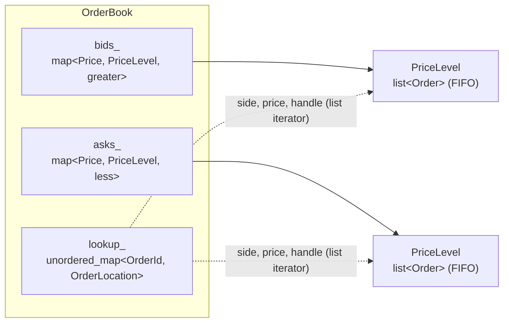
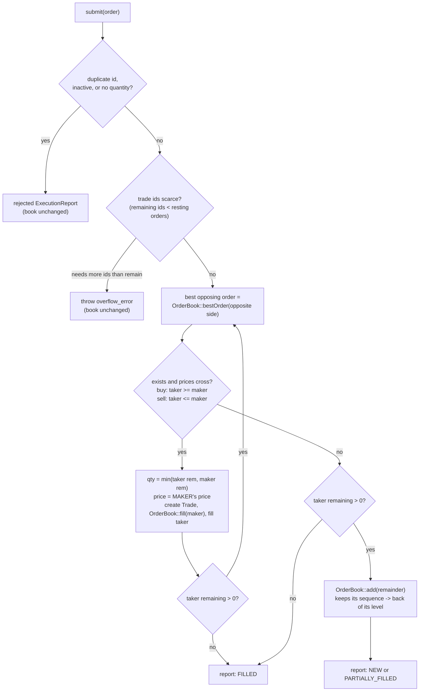

# Architecture

> Status: Phases 1-4 implemented. Sections marked *(planned)* describe code that does not exist yet; see [PROGRESS.md](PROGRESS.md).

## Layering

```
CLI (src/main.cpp)            parsing + printing only, no business logic   (Phase 6)
        |
OrderManager                  validate, add / cancel / modify, reports     (Phase 5)
        |
MatchingEngine                price-time matching, trade generation        (Phase 4, done)
        |
OrderBook -> PriceLevel       storage, ordering, lookup, invariants        (Phases 2-3, done)
        |
OrderTypes / Order / Trade / ExecutionReport   plain domain types          (Phases 1-2, 4)
```

Dependencies only point downward. The core library (`lob_core`) performs no I/O, so the CLI can be replaced by an API or a replay tool, and ExecutionReport is a plain value type.

## Core types (implemented, `include/OrderTypes.h`)

- `Price` and `Quantity` are signed 64-bit integers. Price is in integer ticks, so there is no floating-point error. They are signed so that bad input such as `-5` can be represented and rejected explicitly instead of wrapping around.
- Enums: `Side`, `OrderType` (LIMIT only), `OrderStatus`, `Operation`, `RejectReason`.
- `canTransition` encodes the legal lifecycle (below), so later phases enforce it in a single place.

### Order lifecycle

```
NEW --(partial fill)--> PARTIALLY_FILLED --(partial fill)--> PARTIALLY_FILLED
 |                              |
 |--(full fill)--> FILLED <-----|
 |--(cancel)-----> CANCELLED <--|
 '--(validation fails)--> REJECTED
```

FILLED, CANCELLED and REJECTED are terminal. A terminal order is never in the book or in the lookup map.

## Domain models (implemented, Phase 2)

### Order (`include/Order.h`, `src/Order.cpp`)
- The constructor is private. `Order::create(...)` returns `std::optional<Order>`, so an Order that exists is always valid: id > 0, price > 0, quantity > 0, `0 <= remaining <= original`, and `executed == original - remaining`. `Order::validate` reports the first failing check as a `RejectReason`, in the order id, price, quantity.
- Fields: id, side, type, price (ticks), original/remaining quantity, `sequence` (the time-priority counter assigned by the engine) and status. The model never reads a clock, so tests and replays are deterministic.
- Mutators are `fill(qty)`, `cancel()` and `reject()`. Each one validates the transition with `canTransition` before changing anything, so a failed call leaves the order untouched.
- Misuse (a bad fill quantity, or acting on a terminal order) throws `std::invalid_argument` / `std::logic_error`. External input is checked up front and reported through `create` / `validate`, so these exceptions mean a caller bug, not bad user data.

### Trade (`include/Trade.h`, `src/Trade.cpp`)
- Immutable: there are only getters, and construction goes through `Trade::create`, which returns `std::nullopt` unless the trade id, maker id and taker id are > 0, maker != taker, and price and quantity are > 0.
- It stores maker (resting), taker (incoming) and the **taker side**. `buyOrderId()` and `sellOrderId()` are derived from that, so every trade traces back to its buyer and seller.
- The resting-price execution rule is the matching engine's job (Phase 4). `Trade` only guarantees the price is valid.

### PriceLevel (`include/PriceLevel.h`, `src/PriceLevel.cpp`)
**Ownership.** The level owns its orders by value in a `std::list<Order>`. There are no raw pointers and no shared ownership.

**Iterator strategy.** `std::list` keeps iterators and references to other elements valid when one element is erased or others are appended. `add()` returns an `OrderHandle` (a `list::const_iterator`) that the OrderBook will store in its id -> location map. `remove(handle)` can then erase from the middle of the queue in O(1). A handle stays valid until the order it refers to is removed (by `remove`, `popFront`, or a `fill` that completes the order). Using a handle after that, or on a different level, is a precondition violation and is not detected, because a membership check would cost O(n). The OrderBook owns that guarantee.

**Aggregate integrity.** Orders are exposed read-only (`front()`, `begin()`/`end()`). The only way to change a resting order's quantity is `PriceLevel::fill`, which updates the cached `totalQuantity` in the same call. A fill that completes an order also removes it, so a filled order can never keep resting. `checkInvariants()` recomputes the sum and verifies every order is active, positive and at the level's price (for tests and the Phase 3 invariant checker).

**Failure behaviour.** Preconditions throw and leave the level unchanged. These are `add` with a wrong price or an inactive order, `front`/`popFront` on an empty level, `remove`/`fill` with `end()`, and a bad fill quantity.

| Operation | Time | Notes |
|---|---|---|
| `add` | O(1) | push_back, one node allocation |
| `front`, `empty`, `orderCount`, `totalQuantity`, `price` | O(1) | `std::list::size()` is O(1) since C++11 |
| `popFront` | O(1) | |
| `remove(handle)` | O(1) | the whole point of the list and stored-handle design |
| `fill(handle, qty)` | O(1) | erases the node only if the order completes |
| iteration | O(n) | n = orders at this level |
| `checkInvariants` | O(n) | test and debug use only |

Space is O(n) for n resting orders: one list node per order (the `Order` plus two links and allocator overhead), plus O(1) for the level itself. `std::list` has worse cache locality than a contiguous container. That is the accepted trade-off for O(1) middle removal and stable handles, and Phase 8 will measure it.

## OrderBook (implemented, Phase 3: `include/OrderBook.h`, `src/OrderBook.cpp`)

The book stores, indexes, cancels, fills and queries resting orders. It does **not** decide what matches: that is the matching engine's job (below), which sits on top of it. The book itself can still hold crossing orders if they are added directly.



### Representation
- **Bids:** `std::map<Price, PriceLevel, std::greater<Price>>`. **Asks:** `std::map<Price, PriceLevel, std::less<Price>>`. In both, `begin()` is the best price, so best bid and best ask are O(1).
- **Lookup:** `std::unordered_map<OrderId, OrderLocation>` with `OrderLocation { Side side; Price price; PriceLevel::OrderHandle handle; }`. It is the only id index, and it spans both sides, so id uniqueness is enforced globally.
- Each side is written once as a template over the map type (`addTo`, `removeFrom`, `checkSide`), so the buy and sell sides share one code path. All FIFO and aggregate logic stays in `PriceLevel`.
- The lookup stores the **price**, not a map iterator, and finds the level with an O(log P) `find`. This costs a log factor on cancel. In return one `OrderLocation` type serves both sides, and the entry cannot dangle when a level is erased.

### Iterator and ownership safety
- Levels own orders; the book owns levels; the lookup holds only non-owning handles.
- A handle is invalidated only when its order leaves its level. Every removal path erases the lookup entry in the same operation, and a level is erased only once it is empty, so no handle can point into it. `std::map` nodes never move, so adding or erasing other levels cannot disturb handles.
- `add` has the strong exception guarantee. The level is created first, and any later failure (the lookup insertion) removes the order again and erases a level that was left empty.
- `OrderBook` is **move-only**. Moving a `std::list` or `std::map` keeps iterators valid, but a copy would leave the lookup pointing into the source book's lists, so copying is deleted. A test checks that handles still work after a move.
- `checkInvariants()` compares handles for equality and never dereferences one it has not validated.

### Policies
- **Id reuse:** ids are unique among *resting* orders. Once an order is cancelled its id can be added again (a test covers this). Remembering retired ids is for the order manager (Phase 5).
- **Sequence:** callers submit non-decreasing `sequence` values in arrival order. FIFO position is insertion order, and the invariant checker verifies it agrees with `sequence`. The book does not itself reject out-of-order sequences.
- **Rejections from `add`:** `DuplicateOrderId`, `OrderNotActive`, `InvalidQuantity` (no remaining quantity). Price, id and quantity validity is already guaranteed by `Order::create`. A rejected add leaves the book unchanged.
- **`cancel(id)`:** returns the removed order marked CANCELLED, or `std::nullopt` for an unknown id. That includes a repeated cancel, because the entry is gone.

### Market data
- `bestBid()` / `bestAsk()` return a `LevelSummary {price, totalQuantity, orderCount}` or `nullopt`.
- `spread()` is `bestAsk - bestBid`. It is zero or negative only while the book is crossed. It cannot overflow, because both prices are positive.
- `midPrice()` returns `Midpoint {ticks, halfTick}`, meaning `ticks` is floor((bid + ask) / 2) and `halfTick` says the exact value is `ticks + 0.5`. There is no floating point. It is computed as `bid/2 + ask/2 + (carry of the two odd bits)/2`, so it never forms `bid + ask`, which could overflow near the `Price` maximum (a test covers this).
- `depth(n)` returns the top `n` levels per side, best first, as plain value snapshots. `bids()` / `asks()` give const access to the maps for display, and nothing mutable is exposed.
- `contains(id)`, `find(id)` (a non-owning `const Order*`, valid until that order leaves the book), `orderCount()`, `bidLevelCount()`, `askLevelCount()`, `empty()`.

### Invariants (`checkInvariants()` returns an `InvariantReport` listing each violation)
1. Every price level is non-empty.
2. Bid prices are strictly descending.
3. Ask prices are strictly ascending. (Each level's map key also equals its `price()`.)
4. Every order is on the side whose map contains it.
5. Every order's price equals its level's price.
6. Order ids are unique across both sides.
7. Every resting order has a lookup entry, and that entry has the same side, price and handle.
8. Every lookup entry refers to a resting order. This is shown by 7, unique ids (6) and equal counts (11): N distinct orders each matched to a distinct entry, with N entries in total, leaves no extra entry.
9. Each level's aggregate equals the sum of its orders' remaining quantities (and the level's own checks pass: orders active, remaining > 0).
10. FIFO: within a level, sequences never decrease in queue order.
11. Total orders across all levels equals the lookup size.

I verified the checker is not vacuous with a throwaway program (not committed) that corrupted a book through `#define private public`. A missing entry, an extra entry, a wrong-node entry, drifted aggregates and an empty level were each reported with a specific message. There is no committed test for these failure paths, because the public API cannot produce a corrupt book.

### Complexity (P = price levels on the affected side, L = orders in the level, N = resting orders, D = levels requested)

| Operation | Time | Notes |
|---|---|---|
| `add` | O(log P) + average O(1) | map `find`/insert for the level, O(1) append to the list, average O(1) hash insert. A new level costs O(log P); an existing level costs O(log P) for the `find` only. Hash insert is O(N) worst case on a degenerate hash. |
| `cancel` | O(log P) + average O(1) | average O(1) hash lookup, O(1) removal from the list by handle, then an O(log P) map `find` to reach the level, plus an O(log P) erase if the level empties. **Not O(1) overall**: only the lookup and queue removal are. |
| `contains`, `find` | average O(1) | hash lookup. O(N) worst case. |
| `bestBid`, `bestAsk` | O(1) | `begin()` of an ordered map |
| `spread`, `midPrice` | O(1) | |
| `depth(D)` | O(D) | walks D levels from `begin()`; allocates O(D) |
| `orderCount`, level counts, `empty` | O(1) | |
| `checkInvariants` | O(N) average | one pass plus hash lookups, plus a second id-uniqueness pass |

Space is O(N) for the orders, O(P) for the map nodes, and O(N) for the lookup (one hash node per order). The lookup is the extra cost of maintaining a second index: every add and cancel updates both structures, which is what makes the consistency checks necessary.

## Matching engine (implemented, Phase 4: `include/MatchingEngine.h`, `src/MatchingEngine.cpp`, `include/ExecutionReport.h`)



### Responsibilities
- **MatchingEngine** decides *what* trades: it picks the maker, applies the price rule and quantity, creates `Trade`s, and rests the remainder. It owns the `OrderBook` and the trade history.
- **OrderBook** owns *how* state changes. The engine never touches maps, lists or the lookup directly; it uses only `bestOrder(side)`, `fill(id, qty)`, `add`, `contains`, `orderCount` and read-only views. The book gained exactly two operations in Phase 4:
  - `bestOrder(side)`: the highest-priority resting order (oldest at the best price), read-only.
  - `fill(id, qty)`: executes against a resting order by id. Partial fill: the order keeps its queue position and lookup entry, and the level aggregate is updated. Complete fill: the order leaves its level, its lookup entry is erased and an emptied level is erased, all within the call, so no stale handle survives. It validates before mutating and throws without changing anything on an unknown id or a bad quantity.
- **PriceLevel** is unchanged. `PriceLevel::fill` already kept the aggregate right and removed completed orders.

### Price-time priority
- **Price first:** the maps are ordered best-first, so `bestOrder` is always the best price. **Then time:** within a level, the front of the list is the oldest arrival. Matching never skips an older eligible order.
- A partially filled maker is not moved. Only its remaining quantity changes, so it keeps its place at the front.
- A rested remainder is added with the order's original `sequence`, so it queues behind everything already at that price. The engine adds no clock or sequence of its own.
- The incoming order trades against everything eligible, best price outward, before any remainder rests, so the book is never left crossed by a normal submission.

### Execution price
Every trade executes at the **maker's (resting) price**, so an aggressive order gets price improvement. A buy at 110 against a sell at 105 trades at 105, and a sell at 95 against a bid at 100 trades at 100. The remainder of an incoming order rests at its own limit price, not at a trade price.

### Fills
`quantity = min(taker remaining, maker remaining)`. Each execution produces its own `Trade`, so one order sweeping K resting orders yields K trades. A maker fully consumed is removed. A maker partially consumed stays with the reduced quantity as PARTIALLY_FILLED.

### Trades
- `Trade` fields: id, maker (resting) id, taker (incoming) id, taker side, price, quantity, sequence. Buyer and seller ids come from `buyOrderId()` / `sellOrderId()`, so they are correct whichever side was incoming.
- **Timestamp:** `Trade::sequence` is the taker's `sequence`, the arrival event that caused the execution. Trades from one taker share it and are ordered by trade id. No clock is read, so runs are fully deterministic and no injectable clock was needed.
- **Trade ids:** a plain counter starting at `firstTradeId` (default 1), issued in execution order, with no randomness. Ids are never reused and never wrap. When `UINT64_MAX` is issued the engine is exhausted, and anything that would need another id throws `std::overflow_error`. This is checked **before any mutation**: if remaining ids are fewer than the resting orders (a cheap test), the engine dry-runs the match read-only, counts the executions needed, and refuses if they exceed what remains. An order that would not trade can still rest after exhaustion.
- The engine keeps the full history (`trades()`, a `std::vector<Trade>`), and each report carries the trades of that submission.

### ExecutionReport
A plain value type (no I/O), shared with the future order manager and CLI:
`operation, orderId, accepted, rejectReason, status, originalQuantity, executedQuantity, remainingQuantity, trades`.
- `accepted == false` means rejected (duplicate id, inactive order, no quantity, or invalid raw input). `status` is REJECTED and nothing changed.
- `accepted` with `status NEW` and no trades means it rested without trading. This is distinguishable from a rejection.
- `PARTIALLY_FILLED` means it traded and the remainder rests. `FILLED` means it fully executed and nothing rests.
- `remainingQuantity` is the quantity still working in the book. The final state lives only in `status`, with no second flag.
- `submit(id, side, price, qty, sequence)` validates raw input with `Order::validate` and turns invalid id, price or quantity into a rejected report. `submit(Order)` takes an already valid order.

### Complexity
P = price levels on the opposite side, K = executions (resting orders touched), N = resting orders.

| Operation | Time | Notes |
|---|---|---|
| Best opposing price / oldest order (`bestOrder`) | O(1) | `begin()` of the ordered map and `front()` of the list |
| One execution | O(log P) + average O(1) | hash lookup of the maker, O(1) level update, plus a map `find` to reach its level (O(log P)) and an O(log P) erase if the level empties |
| Matching against K resting orders | O(K log P) + average O(K) | the number of executions drives the cost, not the book size |
| Generating K trades | O(K) | one trade per execution, appended to the report and the history |
| Removing a completely filled maker | O(log P) + average O(1) | included in the execution cost above |
| Inserting an unfilled remainder | O(log P) + average O(1) | the same as `OrderBook::add` |
| Trade-id exhaustion dry run | O(K) | only when remaining ids are fewer than N |

An order that does not trade costs only the O(1) best-price check plus `add`. These are asymptotic statements. No latency has been measured yet (Phase 8), and nothing here claims production-grade performance.

### Exception safety
Rejections and the id-exhaustion check happen before any change. If an allocation fails part-way through a match (`bad_alloc`), every execution already applied is complete and recorded and the book still satisfies its invariants, but the incoming order is not rested (basic guarantee). Each execution records the trade before mutating, and the permanent history is pushed last.

## Data structure summary

| Structure | Purpose | Why |
|---|---|---|
| `std::map<Price, PriceLevel, std::greater<>>` (bids) | Price levels, best bid first | Ordered iteration gives price priority. `begin()` is the best bid, O(log P) insert/erase. |
| `std::map<Price, PriceLevel>` (asks) | Price levels, best ask first | Same, ascending. |
| `std::list<Order>` inside each `PriceLevel` | FIFO queue at one price | List iterators stay valid when other elements are erased, so removing an order from the middle is O(1) with a stored iterator. `std::deque` was the suggested alternative, but erasing from the middle of a deque is O(n) and invalidates iterators. See the decision below. |
| `std::unordered_map<OrderId, OrderLocation>` | Order ID -> (side, price, list iterator) | Average O(1) cancel/modify lookup and O(1) duplicate-ID detection. |
| `std::vector<Trade>` (in `MatchingEngine`) | Append-only trade history | Cache-friendly sequential storage. `Trade` is immutable and copyable (not assignable), which is fine for an append-only log. |
| `std::optional` | Optional results (for example best bid on an empty side) | Avoids sentinel values. |

### Decision: `std::list` rather than `std::deque` for the level queue

The specification lists both. A deque gives better cache locality but cannot delete from the middle in O(1) and does not keep iterators valid across erase. Order cancellation at an arbitrary queue position is a core requirement, and the order lookup map must hold stable handles, so `std::list` is the correct primary choice. `std::deque` is not forced into the design where it would be wrong. If the benchmarks (Phase 8) justify it, a deque with lazy deletion can be evaluated and documented as an experiment.

### Priority rules
- Price priority first, then arrival sequence. *(Phase 4, implemented)*
- Trades execute at the resting order's price. *(Phase 4, implemented)*
- Modify *(to be implemented, Phase 5)*: a price change cancels and re-enters the order with a new sequence (loses priority). A quantity increase also loses priority. A quantity decrease keeps priority and the order stays in place. Modifying a terminal order is rejected.

## Testing approach

`tests/TestFramework.h` is a small self-registering harness (about 60 lines) so the repository builds offline with no dependency. Each `*Tests.cpp` is its own executable and ctest entry. Porting to GoogleTest later is mechanical (`TEST`, `CHECK`, `CHECK_EQ` map to `TEST`, `EXPECT_TRUE`, `EXPECT_EQ`).
